# Guide to the studies

A visual way into this repository. What each study asks, why it was worth asking, how it works, what it found, and
what to read first. The READMEs in each folder have the full method and every number; this page is the map.

Every claim has a source. Published work is cited by first author and year, with the full reference and DOI in the
[reading list](#5-reading-list-in-order). Our own numbers link to the results file they come from.

Contents:

1. [The question in one picture](#1-the-question-in-one-picture)
2. [Primer: the ideas the studies rest on](#2-primer-the-ideas-the-studies-rest-on)
3. [How the studies led to each other](#3-how-the-studies-led-to-each-other)
4. [The studies, one card each](#4-the-studies-one-card-each)
5. [Reading list, in order](#5-reading-list-in-order)
6. [Glossary](#6-glossary)

## 1. The question in one picture

A genome differs from the reference at 4 to 5 million sites (1000 Genomes 2015). A diagnostic pipeline filters
them by gene panel, frequency and consequence to a short list of candidates, then a scientist reviews them in order
(Smedley 2015; Whiffin 2017). Scores decide that order. In our test cases the list has a median of 235 rare variants
([`rare-disease/results/results.json`](rare-disease/results/results.json)). Genomic foundation models promise better
scores. Do they put the diagnosis nearer the top?

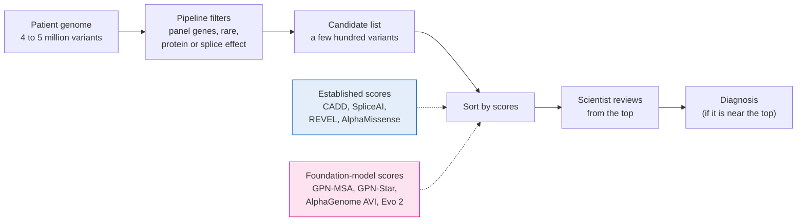

Every study here is a version of one test: **does adding a foundation-model score move the diagnostic variant
up the list, compared with the scores labs already use?**

## 2. Primer: the ideas the studies rest on

### 2.1 What a variant score is

A variant score is a number a computer program gives each variant. A higher number means the variant is more likely
to damage a gene. Labs use these numbers in two ways:

1. **To sort a patient's candidate list**, so the most likely culprits are read first (Smedley 2015).
2. **As evidence when classifying a variant.** In the ACMG/AMP rules, a damaging prediction counts as code PP3 and a
   harmless one as BP4 (Richards 2015; Pejaver 2022).

Our studies test the first use: sorting.

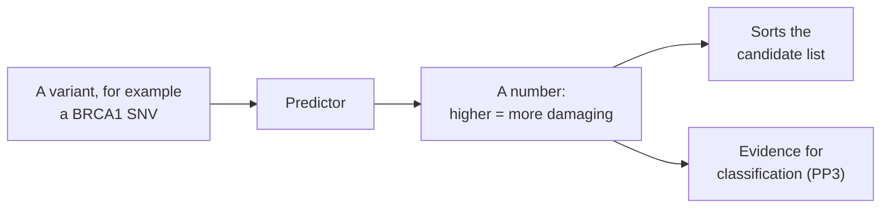

### 2.2 The scores we compare, and how a lab gets them

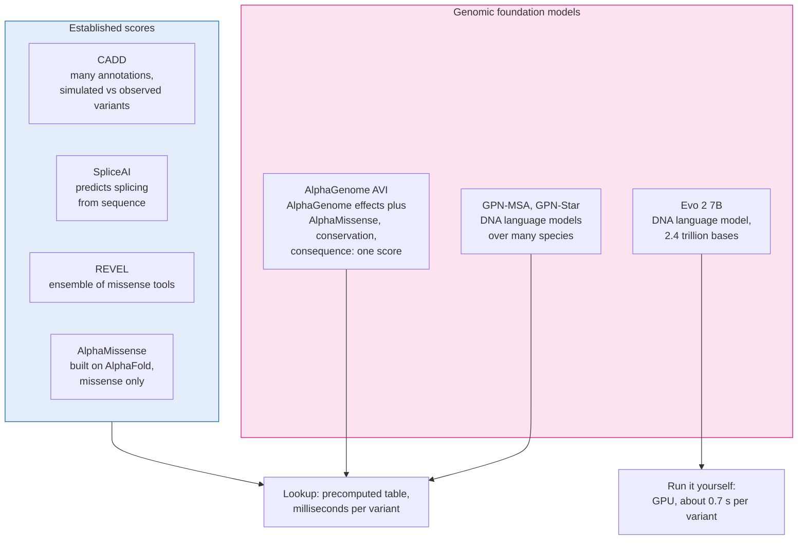

Sources: CADD (Kircher 2014; Schubach 2024), SpliceAI (Jaganathan 2019), REVEL (Ioannidis 2016), AlphaMissense
(Cheng 2023), GPN-MSA (Benegas 2025), GPN-Star (Ye 2026), AlphaGenome and AVI (Avsec 2026; Cheng 2026), Evo 2
(Brixi 2026). The 0.7 s per variant is from our own H100 run: 2.9 windows per second, two windows per variant
([`rare-disease/evo2/README.md`](rare-disease/evo2/README.md)).

**Most scores come as a table.** The developers run their model once on every possible variant and publish the
results as a file. For SNVs that is about 9 billion rows. A lab then looks each variant up by its position and
allele. This takes milliseconds, needs no GPU, and gives the same answer every time. Labs already use the
established scores this way: CADD publishes a score for every possible SNV (Schubach 2024), and REVEL and
AlphaMissense for every possible missense change (Ioannidis 2016; Cheng 2023). In our studies, SpliceAI also came
from a table (the SpliceAI scores in CADD's annotations); for indels we ran SpliceAI ourselves.

**A foundation model** is a large model trained on DNA sequence (and, for AlphaGenome, on lab measurements of
molecular activity), not on lists of disease variants. Three of the ones we test publish a genome-wide table, so a
lab can use them exactly like CADD: GPN-MSA, GPN-Star and AlphaGenome AVI.

AVI is not a pure foundation-model score. It combines AlphaGenome's predictions with AlphaMissense, conservation and
the variant's consequence, using a model trained to tell rare from common variants in gnomAD (Cheng 2026).

**Evo 2 has no genome-wide table.** EVEE publishes scores built on Evo 2, but only for the about 4.25 million
variants already in ClinVar (Pearce 2026). Most of a patient's rare variants are not in ClinVar. To score those, a
lab has to run Evo 2 itself on a GPU, which costs money and, as we found, can give slightly different answers on
different GPUs.

### 2.3 Why we test whole cases, not single variants

Most papers test a score on a big list of variants already labelled pathogenic or benign, and report one number for
how well it separates them (the AUROC). That is not the lab's question. The lab's question is: **for this patient,
is the variant that causes the disease near the top of the list?**

The two can disagree. In ClinVar, 98% of nonsense variants are pathogenic and 0.1% of synonymous ones (Pearce 2026).
So a score can get a high AUROC just by recognising the type of variant. That does not help a lab whose list already
contains many variants of the same types. Variant-level tests can also look better than they are when the score was
trained on the same variants (Grimm 2015), or because some genes have far more pathogenic variants than others
(Lu 2026).

So we build cases instead. Each case is one person's list of rare variants with one known disease-causing variant
added. We sort the list by a score and record where the disease-causing variant lands.

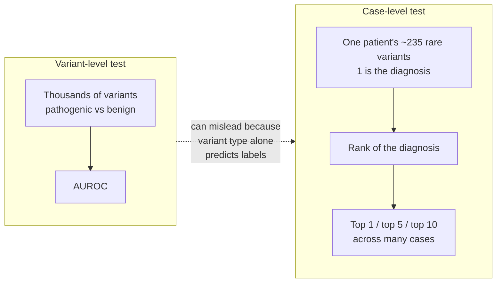

We report the result as **top 1** and **top 5**: the share of cases in which the disease-causing variant was ranked
first, or among the first five. Top 1 means the score found the answer outright. Top 5 means the answer was on the
first screen a scientist reads.

### 2.4 Combining scores: what does a new score add?

A lab never sorts by one score alone. It looks at several together: CADD, SpliceAI for splicing, REVEL or
AlphaMissense for missense changes, and the type of variant. So the useful question is not "how good is the new
score?" but **"does it help on top of the scores a lab already has?"**

To answer that, several scores have to be turned into one sort order. We use logistic regression, a standard
statistical model. It looks at cases where we know the answer and learns how much weight to give each score. For
example, it can learn to trust SpliceAI for intronic variants and REVEL for missense ones.

We build two versions and compare them on the same cases:

1. **Lookups combined.** CADD, SpliceAI, REVEL, AlphaMissense and the variant type. This stands in for what a lab
   has today.
2. **Lookups plus one new score.** The same, plus one foundation-model score.

The difference between them is what the new score adds. On the 200 SNV cases, for example, the lookups combined
rank the disease-causing variant first in 59.5% of cases; adding AVI raises that to 67.0%, a gain of 7.5 points.

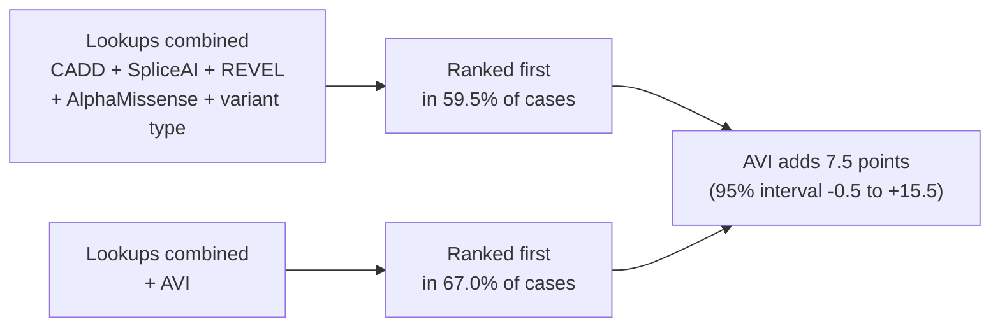

Two safeguards keep this honest:

- **The model never ranks a case it learned from.** The cases come from 50 people. We learn the weights on the
  cases of four fifths of them and rank the cases of the remaining fifth, then rotate until every case has been
  ranked (cross-validation).
- **Every gain has a 95% interval.** We resample the 50 people 1,000 times and recompute the gain each time (a
  bootstrap). If the interval includes zero, we cannot be sure the new score helps.

Numbers: [`rare-disease/results/results.json`](rare-disease/results/results.json); method:
[`rare-disease/README.md`](rare-disease/README.md).

### 2.5 Four ways this kind of test can mislead, and how we checked each

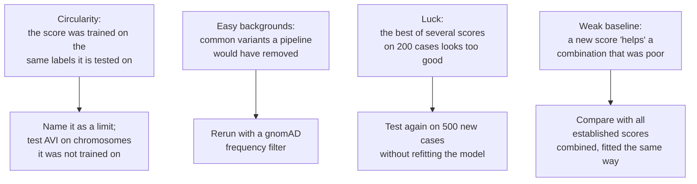

1. **Circularity.** If a score was trained on the same variants it is tested on, it will look too good (Grimm 2015).
   AVI's developers trained it on some chromosomes and not others (Cheng 2026), so we checked its ranking on the
   chromosomes it never saw ([`rare-disease/REPLICATION.md`](rare-disease/REPLICATION.md)).
2. **Easy backgrounds.** Our backgrounds are rare in 1000 Genomes, but a real pipeline also removes anything common
   in gnomAD (Whiffin 2017). Leaving those in could make the task too easy for some scores, so we reran with a gnomAD
   frequency filter. A later review found a second problem the filter does not fix: the 1000 Genomes people are
   themselves in gnomAD, so every background variant has a gnomAD frequency while most diagnostic variants have none.
   A real patient's private variants are not in gnomAD. The second run in
   [`rare-disease-v2/`](rare-disease-v2/) leaves each person and their family out of the frequencies
   ([issue #1](https://github.com/rewire-bio/amp-2026-studies/issues/1)).
3. **Luck.** Test five scores on 200 cases and one will look best partly by chance. So we froze the fitted model
   ("locked") and tested it on 500 new cases from 50 different people.
4. **Weak baseline.** A new score can look useful only because the comparison was poor. So the baseline is all the
   established scores combined by the same method, not one score on its own.

## 3. How the studies led to each other

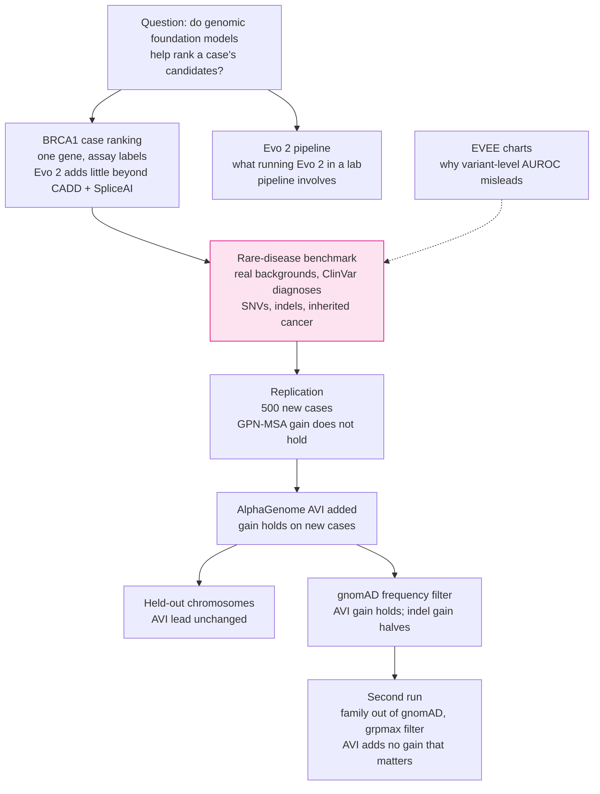

## 4. The studies, one card each

### 4.1 Rare-disease case benchmark (the main study)

> **Question.** Put one known disease-causing variant into a real person's rare variants. How often does each score
> rank it first, or in the top 5? Does adding a foundation-model score to the established lookups help?
>
> **Why.** This is the closest public approximation of a lab's candidate list. It uses real backgrounds, real
> ClinVar diagnoses and the scores labs already have.
>
> **Folder.** [`rare-disease/`](rare-disease/), with the follow-up checks in
> [`rare-disease/REPLICATION.md`](rare-disease/REPLICATION.md).

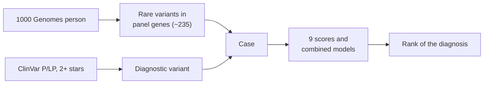

Four studies share this design: 200 SNV cases, 120 indel cases, 140 inherited cancer cases, and a 500-case
replication with 50 new people ([`rare-disease/README.md`](rare-disease/README.md)). Backgrounds come from 1000
Genomes (Byrska-Bishop 2022), genes from PanelApp (Martin 2019) on MANE transcripts (Morales 2022), and diagnoses
from ClinVar (Landrum 2018).

Each single score on its own, 200 SNV cases, share of cases with the diagnosis in the top 5:

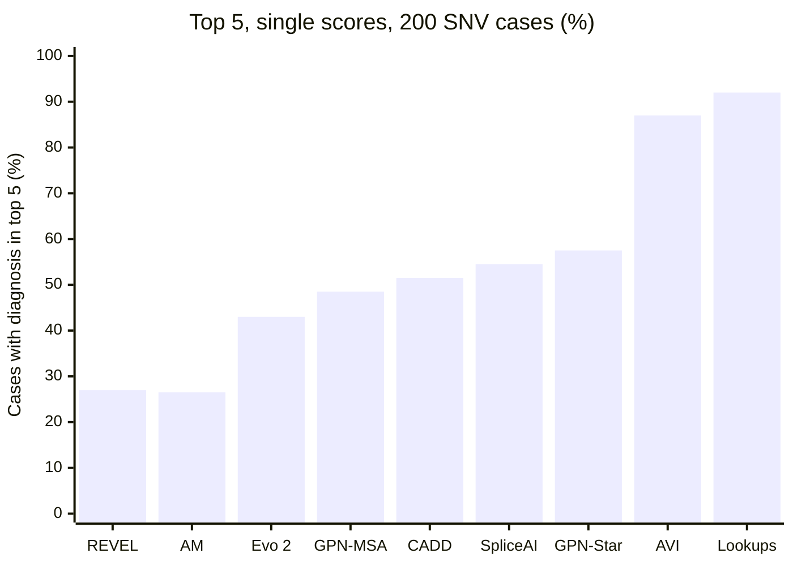

AM is AlphaMissense, GPN-Star the vertebrate model, and Lookups the established scores combined. REVEL and
AlphaMissense score only missense variants, so they miss every other diagnosis. AVI is the best single
score; the established lookups combined are better still. Source:
[`rare-disease/results/results.json`](rare-disease/results/results.json), `strata.all.scores`.

How much adding AVI to the lookups helps at top 1, as the tests got stricter:

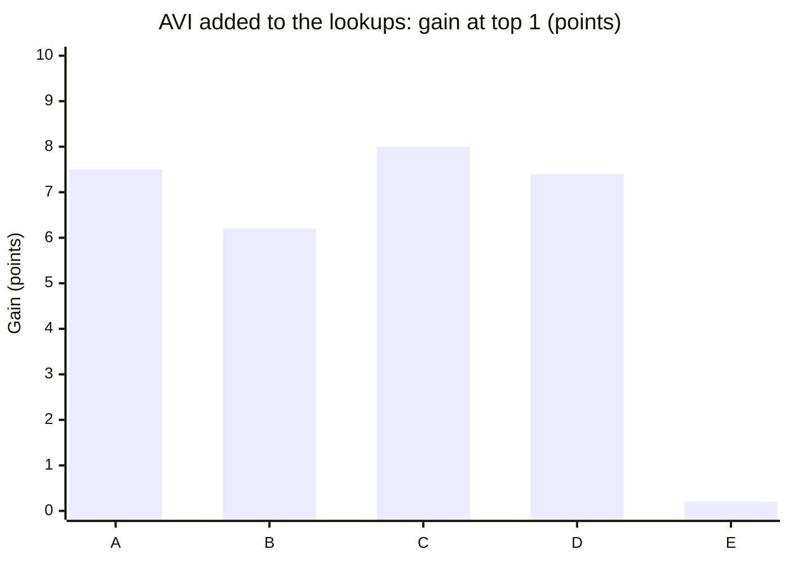

| Bar | Cases | Frequency filter | Source |
|---|---|---|---|
| A | The first 200 | None | [`results.json`](rare-disease/results/results.json) |
| B | 500 new, model locked | None | [`results_replication.json`](rare-disease/results/results_replication.json) |
| C | The first 200 | gnomAD AF below 0.1% | [`results_gnomad0.001.json`](rare-disease/results/results_gnomad0.001.json) |
| D | 500 new, model locked | gnomAD AF below 0.1% | [`results_replication_gnomad0.001.json`](rare-disease/results/results_replication_gnomad0.001.json) |
| E | 500 new, model locked | Strict: grpmax AF below 0.1% | [`results_replication_gnomad0.001_grpmax.json`](rare-disease/results/results_replication_gnomad0.001_grpmax.json) |

Each bar is uncertain by 5 to 8 points either way, so read them as a group. The gain of about 6 to 8 points survives
new cases and a normal frequency filter. Under the strict filter it disappears. That filter shrinks each list to a
median of 35 to 51 variants, and the lookups alone already rank the disease-causing variant first in 74 to 80% of
cases, so there is little left for any new score to improve.

**Findings in one line each** (all from [`rare-disease/results/`](rare-disease/results/)):

- The established lookups, combined, do most of the work.
- AVI is the one foundation-model table whose gain holds on new cases.
- GPN-MSA's +6 point gain on the first 200 cases did not replicate.
- On indels, Evo 2 adds +16 points at top 1, or +8 after a frequency filter.
- On a realistic short list, little room is left for any new score to help.

**Read first:** Richards 2015 (how labs classify variants), Pejaver 2022 (score thresholds as evidence), Martin 2019
(PanelApp), Byrska-Bishop 2022 (the 1000 Genomes backgrounds), Cheng 2026 (the AlphaGenome Atlas preprint and its
own rare-disease test), Grimm 2015 (circularity).

### 4.2 Evo 2 on the case variants

> **Question.** What does it take to score every case variant with a model that has no genome-wide table, and does its score
> help?
>
> **Why.** Evo 2 is the largest openly released DNA foundation model (Brixi 2026), and a lab could only use it on
> a patient's variants by running it.
>
> **Folder.** [`rare-disease/evo2/`](rare-disease/evo2/)

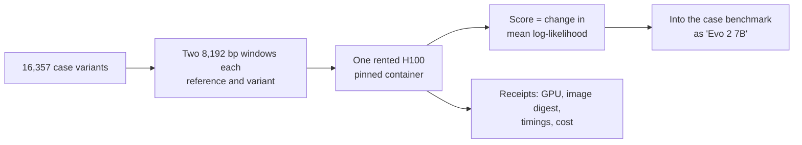

Two runs took about 3.5 hours of pod time and cost about USD 14. Throughput was 2.9 windows per second
([`rare-disease/evo2/README.md`](rare-disease/evo2/README.md)). On SNVs, Evo 2 alone was among the weaker scores
(43% top 5, [`results.json`](rare-disease/results/results.json)). On indels, where few tables exist, it was the
strongest single score (92.5% top 5) and added the largest gain to the lookups
([`results_indel.json`](rare-disease/results/results_indel.json)).

**Read first:** Brixi 2026 (Evo 2), Arc Institute's
[BRCA1 zero-shot notebook](https://github.com/ArcInstitute/evo2/blob/main/notebooks/brca1/brca1_zero_shot_vep.ipynb)
(the scoring method followed here).

### 4.3 BRCA1 case ranking

> **Question.** On one gene with lab-measured function, does Evo 2 put the loss-of-function variant near the top of
> a simulated case?
>
> **Why.** It was the first case-level test. Saturation genome editing gives a functional label for 96.5% of
> possible SNVs in 13 BRCA1 exons (Findlay 2018), so it does not depend on ClinVar.
>
> **Folder.** [`brca1-case-ranking/`](brca1-case-ranking/)

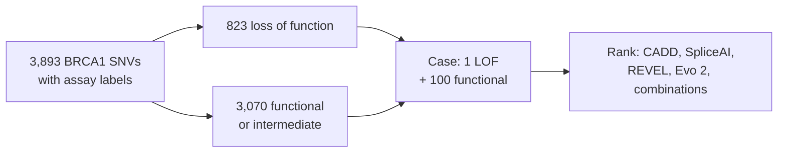

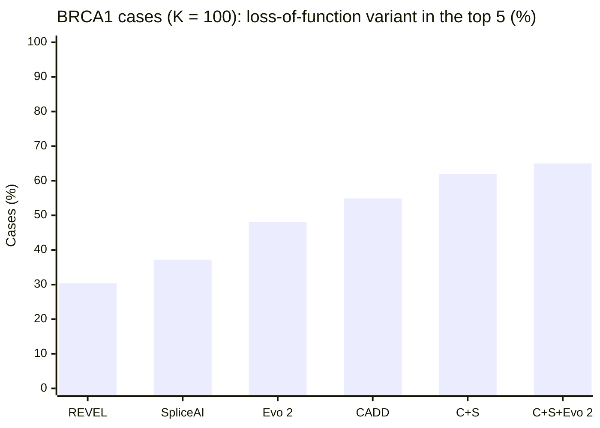

C+S is the type-aware CADD + SpliceAI combination. Evo 2 adds about 3 points to it, but against the best existing score for each variant type no gain is detected. The study
also showed that how scores are combined matters as much as which scores are combined. That lesson shaped the
rare-disease design. Source: [`brca1-case-ranking/README.md`](brca1-case-ranking/README.md) and
[`results.json`](brca1-case-ranking/results.json).

**Read first:** Findlay 2018 (BRCA1 saturation genome editing).

### 4.4 Evo 2 pipeline

> **Question.** What does adding an Evo 2 score to a lab pipeline involve in practice?
>
> **Why.** A score is only useful if it can run inside a validated, reproducible pipeline.
>
> **Folder.** [`evo2-pipeline/`](evo2-pipeline/)

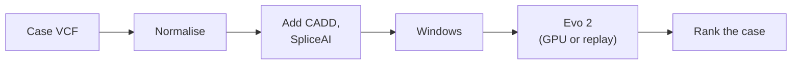

It is a Nextflow pipeline with two profiles. `replay` runs on a laptop with recorded H100 scores and has been run
end to end. `gpu` uses the same scoring code but has not been run end to end through Nextflow. The GPU, cost and
reproducibility findings shown in the talk, including scores that drift between GPU types, come from the separate
[evo2-cloud-operations](https://github.com/rewire-bio/evo2-cloud-operations) study.

Source: [`evo2-pipeline/README.md`](evo2-pipeline/README.md).

**Read first:** Di Tommaso 2017 (Nextflow), NVIDIA's
[cuBLAS results reproducibility notes](https://docs.nvidia.com/cuda/cublas/index.html#results-reproducibility) (why
GPU results can differ between GPU types).

### 4.5 EVEE charts

> **Question.** None of our own. This folder redraws two figures from Goodfire's EVEE preprint for the slides.
>
> **Why they matter here.** They show the trap from section 2.3. In ClinVar, a variant's consequence alone predicts
> much of its label, so variant-level benchmarks reward scores that learn consequence. Within each consequence,
> AUROCs are lower (for CADD v1.7, 0.99 overall against about 0.79 to 0.95 within a consequence) and the gaps between
> methods change (Pearce 2026; data from
> [goodfire-ai/evee-manuscript](https://github.com/goodfire-ai/evee-manuscript)).
>
> **Folder.** [`evee/`](evee/)

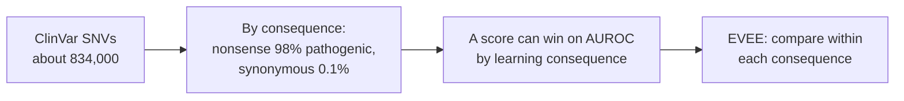

**Read first:** Pearce 2026 (EVEE).

### 4.6 Rare-disease case tests, second run

> **Question.** The same as 4.1, on the intellectual disability panel only: with the frequencies a real patient's
> pipeline would see, does adding AlphaGenome AVI to the lookups still help on new cases?
>
> **Why.** Review of the first run found that the 1000 Genomes background people are in gnomAD, so "not in gnomAD"
> alone picks out the diagnostic variant in about three quarters of cases
> ([issue #1](https://github.com/rewire-bio/amp-2026-studies/issues/1)). It also found that the realistic grpmax
> filter was only a side check, and that the combined model loses to the matching single tool within each variant
> type ([issue #2](https://github.com/rewire-bio/amp-2026-studies/issues/2)).
>
> **Folder.** [`rare-disease-v2/`](rare-disease-v2/): [proposal](rare-disease-v2/PROPOSAL.md),
> [protocol](rare-disease-v2/PROTOCOL.md), [work plan](rare-disease-v2/PLAN.md) and
> [results](rare-disease-v2/README.md#results).

What changes: gnomAD frequencies without the person and their family; a grpmax filter below 0.1% and an
inheritance filter built into the cases; one consequence annotation throughout; a rule-based baseline (each variant
scored by the tool for its type) next to the combined lookups; shared bootstrap resamples, so adding a score never
moves another interval. The scores are the
four lookups and AVI, with GPN-MSA, GPN-Star and EVEE as secondary scores. Evo 2 is left out and can be added later on
the same indel cases. The inherited cancer panel is dropped.

Status: done. On 500 new cases with the model locked, adding AVI to the lookups raises top 1 from 90.6% to 92.4%, a
gain of +1.8 points (95% interval -0.4 to +4.0): no gain that matters by the rule fixed in advance. The first run
reported +6.2 (0.0 to +13.0) without a frequency filter and +0.2 (-3.6 to +3.8) under grpmax; the second run agrees
with the grpmax result. AVI helps only with non-coding diagnostics, and GPN-MSA and GPN-Star add nothing. Results:
[`rare-disease-v2/README.md`](rare-disease-v2/README.md). The numbers in 4.1 are still the first run's.

## 5. Reading list, in order

A path from the clinical setting to the models, then to the evaluation problems. The bold items are the ones to read
if time is short.

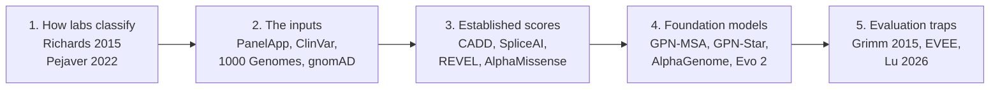

**1. How labs classify variants**

- **Richards S et al. (2015).** Standards and guidelines for the interpretation of sequence variants (ACMG/AMP).
  *Genetics in Medicine* 17:405-424. [doi:10.1038/gim.2015.30](https://doi.org/10.1038/gim.2015.30)
- **Pejaver V et al. (2022).** Calibration of computational tools for missense variant pathogenicity
  classification and ClinGen recommendations for PP3/BP4 criteria. *AJHG* 109:2163-2177.
  [doi:10.1016/j.ajhg.2022.10.013](https://doi.org/10.1016/j.ajhg.2022.10.013)
- Walker LC et al. (2023). Using the ACMG/AMP framework to capture evidence related to predicted and observed impact
  on splicing: recommendations from the ClinGen SVI Splicing Subgroup. *AJHG* 110:1046-1067. [doi:10.1016/j.ajhg.2023.06.002](https://doi.org/10.1016/j.ajhg.2023.06.002)
- Bergquist T et al. (2025). Calibration of additional computational tools expands ClinGen recommendation options
  for variant classification with PP3/BP4 criteria. *Genetics in Medicine* 27:101402.
  [doi:10.1016/j.gim.2025.101402](https://doi.org/10.1016/j.gim.2025.101402)
- Smedley D et al. (2015). Next-generation diagnostics and disease-gene discovery with the Exomiser. *Nature
  Protocols* 10:2004-2015. [doi:10.1038/nprot.2015.124](https://doi.org/10.1038/nprot.2015.124). How a real
  pipeline ranks candidates.

**2. The inputs the cases are built from**

- **Martin AR et al. (2019).** PanelApp crowdsources expert knowledge to establish consensus diagnostic gene panels.
  *Nature Genetics* 51:1560-1565. [doi:10.1038/s41588-019-0528-2](https://doi.org/10.1038/s41588-019-0528-2)
- 1000 Genomes Project Consortium (2015). A global reference for human genetic variation. *Nature* 526:68-74.
  [doi:10.1038/nature15393](https://doi.org/10.1038/nature15393). Source of "4 to 5 million variants per genome".
- Byrska-Bishop M et al. (2022). High-coverage whole-genome sequencing of the expanded 1000 Genomes Project cohort
  including 602 trios. *Cell* 185:3426-3440.e19. [doi:10.1016/j.cell.2022.08.004](https://doi.org/10.1016/j.cell.2022.08.004)
- Landrum MJ et al. (2018). ClinVar: improving access to variant interpretations and supporting evidence. *Nucleic
  Acids Research* 46:D1062-D1067. [doi:10.1093/nar/gkx1153](https://doi.org/10.1093/nar/gkx1153). Review stars:
  [ClinVar review status](https://www.ncbi.nlm.nih.gov/clinvar/docs/review_status/).
- Chen S et al. (2024). A genomic mutational constraint map using variation in 76,156 human genomes (gnomAD).
  *Nature* 625:92-100. [doi:10.1038/s41586-023-06045-0](https://doi.org/10.1038/s41586-023-06045-0). The grpmax
  definition: [gnomAD help](https://gnomad.broadinstitute.org/help/grpmax).
- Whiffin N et al. (2017). Using high-resolution variant frequencies to empower clinical genome interpretation.
  *Genetics in Medicine* 19:1151-1158. [doi:10.1038/gim.2017.26](https://doi.org/10.1038/gim.2017.26). Why
  pipelines filter on frequency first.
- Findlay GM et al. (2018). Accurate classification of BRCA1 variants with saturation genome editing. *Nature*
  562:217-222. [doi:10.1038/s41586-018-0461-z](https://doi.org/10.1038/s41586-018-0461-z). The BRCA1 assay labels.
- Morales J et al. (2022). A joint NCBI and EMBL-EBI transcript set for clinical genomics and research (MANE).
  *Nature* 604:310-315. [doi:10.1038/s41586-022-04558-8](https://doi.org/10.1038/s41586-022-04558-8)

**3. Established scores**

- Kircher M et al. (2014). A general framework for estimating the relative pathogenicity of human genetic variants
  (CADD). *Nature Genetics* 46:310-315. [doi:10.1038/ng.2892](https://doi.org/10.1038/ng.2892)
- **Schubach M et al. (2024).** CADD v1.7: using protein language models, regulatory CNNs and other
  nucleotide-level scores to improve genome-wide variant predictions. *Nucleic Acids Research* 52:D1143-D1154.
  [doi:10.1093/nar/gkad989](https://doi.org/10.1093/nar/gkad989)
- **Jaganathan K et al. (2019).** Predicting splicing from primary sequence with deep learning (SpliceAI). *Cell*
  176:535-548.e24. [doi:10.1016/j.cell.2018.12.015](https://doi.org/10.1016/j.cell.2018.12.015)
- Ioannidis NM et al. (2016). REVEL: an ensemble method for predicting the pathogenicity of rare missense variants.
  *AJHG* 99:877-885. [doi:10.1016/j.ajhg.2016.08.016](https://doi.org/10.1016/j.ajhg.2016.08.016)
- **Cheng J et al. (2023).** Accurate proteome-wide missense variant effect prediction with AlphaMissense. *Science*
  381:eadg7492. [doi:10.1126/science.adg7492](https://doi.org/10.1126/science.adg7492)

**4. Genomic foundation models**

- **Benegas G et al. (2025).** A DNA language model based on multispecies alignment predicts the effects of
  genome-wide variants (GPN-MSA). *Nature Biotechnology* 43:1960-1965.
  [doi:10.1038/s41587-024-02511-w](https://doi.org/10.1038/s41587-024-02511-w)
- Ye C et al. (2026). Predicting genome-wide functional constraints with GPN-Star. *Nature*.
  [doi:10.1038/s41586-026-11005-5](https://doi.org/10.1038/s41586-026-11005-5)
- **Avsec Ž et al. (2026).** Advancing regulatory variant effect prediction with AlphaGenome. *Nature*
  649:1206-1218. [doi:10.1038/s41586-025-10014-0](https://doi.org/10.1038/s41586-025-10014-0)
- **Cheng J et al. (2026).** AlphaGenome Atlas: in silico mutagenesis of the entire human genome improves
  prioritization and interpretation of non-coding variants. *medRxiv*.
  [doi:10.64898/2026.09.16.26363192](https://doi.org/10.64898/2026.09.16.26363192). The source of the AVI table,
  its training chromosomes and the 0.1% frequency filter used here.
- **Brixi G et al. (2026).** Genome modelling and design across all domains of life with Evo 2. *Nature*
  652:1349-1361. [doi:10.1038/s41586-026-10176-5](https://doi.org/10.1038/s41586-026-10176-5)

**5. Evaluation traps**

- **Grimm DG et al. (2015).** The evaluation of tools used to predict the impact of missense variants is hindered
  by two types of circularity. *Human Mutation* 36:513-523.
  [doi:10.1002/humu.22768](https://doi.org/10.1002/humu.22768)
- **Pearce MT et al. (2026).** Interpretable variant effect prediction from genomic foundation model
  representations (EVEE). *bioRxiv*. [doi:10.64898/2026.04.10.717844](https://doi.org/10.64898/2026.04.10.717844)
- Lu B et al. (2026). Genomic heterogeneity inflates the performance of variant pathogenicity predictions.
  *Nature Communications*, online 30 October 2026.
  [doi:10.1038/s41467-026-78623-5](https://doi.org/10.1038/s41467-026-78623-5). Preprint:
  [doi:10.1101/2025.09.05.674459](https://doi.org/10.1101/2025.09.05.674459)
- Kong SW et al. (2025). Discordance between a deep learning model and clinical-grade variant pathogenicity
  classification in a rare disease cohort. *npj Genomic Medicine* 10:17.
  [doi:10.1038/s41525-025-00480-w](https://doi.org/10.1038/s41525-025-00480-w)
- Curtis D (2025). Assessment of ability of a DNA language model to predict pathogenicity of rare coding variants.
  *Journal of Human Genetics* 70:603-607.
  [doi:10.1038/s10038-025-01385-3](https://doi.org/10.1038/s10038-025-01385-3)
- Di Tommaso P et al. (2017). Nextflow enables reproducible computational workflows. *Nature Biotechnology*
  35:316-319. [doi:10.1038/nbt.3820](https://doi.org/10.1038/nbt.3820)

## 6. Glossary

| Term | Meaning |
|---|---|
| ACMG/AMP | The standard framework for classifying variants into five classes: pathogenic, likely pathogenic, uncertain significance, likely benign, benign (Richards 2015) |
| PP3, BP4 | ACMG/AMP evidence codes for computational predictions supporting pathogenic or benign |
| P/LP | Pathogenic or likely pathogenic |
| ClinVar review stars | How well supported a ClinVar classification is. 2 stars: two or more submitters with criteria and no conflict; 3: expert panel; 4: practice guideline |
| Background | The rare variants of one 1000 Genomes person, into which a diagnostic variant is inserted |
| Top k | Share of cases with the diagnostic variant in the first k positions |
| Lookups combined | Logistic regression on CADD, SpliceAI, REVEL, AlphaMissense and consequence class |
| Locked | A model fitted on the first 200 cases and applied unchanged to the 500 new ones |
| Bootstrap interval | A 95% range from resampling the background people 1,000 times |
| AF, grpmax AF | Allele frequency in gnomAD. grpmax is the highest frequency among the large, non-bottlenecked ancestry groups (for genomes: afr, amr, eas, nfe, sas) |
| Zero-shot | Using a model's own likelihoods as a score, without training on labels |
| Log-likelihood delta | How much less likely the model finds the variant sequence than the reference |
| SGE | Saturation genome editing: nearly every possible SNV in a region made in cells and its effect measured (Findlay 2018) |
| AUROC | How well a score separates two groups across all thresholds; 1 is perfect, 0.5 is chance |
