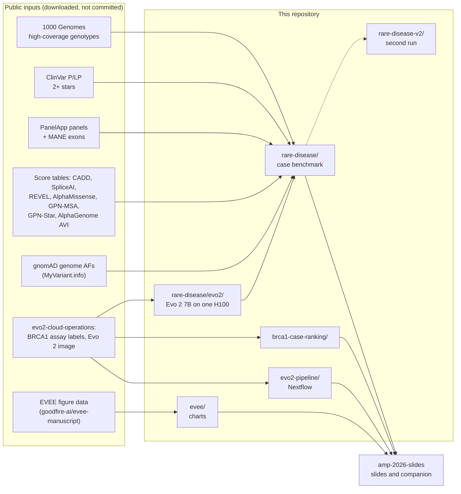

# AMP 2026 studies

The code, data and results behind Tim Richardson's AMP 2026 talk, "Scoring variants with genomic foundation models"
(14 November 2026). The slides, narration and companion document are in
[rewire-bio/amp-2026-slides](https://github.com/rewire-bio/amp-2026-slides). Every number the talk reports from our
own work comes from a file in this repository, and the companion cites it at a tag (currently `amp-2026-v4`).

New to this work? Start with the [visual guide](https://rewire-bio.github.io/amp-2026-studies/) (also in
[`GUIDE.md`](GUIDE.md)): what each study asks and why, the ideas behind it, and a reading list.
`python3 docs/build_site.py` rebuilds the page from `GUIDE.md`.

## What is here



| Folder | Question | Slides |
|---|---|---|
| [`rare-disease/`](rare-disease/) | Put one known disease-causing variant among a real person's rare variants. Where does each score rank it? SNVs, indels, inherited cancer, a 500-case replication, and checks for training-data leakage and frequency filtering | `rd-design`, `rd-results`, `rd-combine`, `rd-indels`, `rd-limits`, `cancer-germline`, `cancer-pp3`, `matrix`, `takeaways` |
| [`rare-disease/evo2/`](rare-disease/evo2/) | Evo 2 7B zero-shot scores for every case variant, on one rented H100, with receipts | `rd-combine`, `scale-cost`, `worked-score` |
| [`brca1-case-ranking/`](brca1-case-ranking/) | On BRCA1 saturation genome editing labels, does Evo 2 put the loss-of-function variant near the top of a simulated case? | backup `bench-*` |
| [`evo2-pipeline/`](evo2-pipeline/) | What it takes to add an Evo 2 score to a lab's pipeline, as a working Nextflow pipeline | `pipeline-overview`, backup `code-*` |
| [`evee/`](evee/) | EVEE's published figure data redrawn as two charts | `evee-confounding`, `evee-results` |
| [`gpu-drift/`](gpu-drift/) | What a flipped call is, from the recorded H100 and L40S BRCA1 runs in evo2-cloud-operations | `gpu-drift` |
| [`rare-disease-v2/`](rare-disease-v2/) | Second run of the rare-disease case tests, intellectual disability panel only, with gnomAD frequencies that leave out each person's family, a grpmax filter and an inheritance filter built in. Done: adding AVI to the lookups gains +1.8 points at top 1 (-0.4 to +4.0) on 500 new cases, no gain that matters | will replace the `rd-*` numbers |

The rare-disease benchmark is the main study. Start with [`rare-disease/README.md`](rare-disease/README.md), then
[`rare-disease/REPLICATION.md`](rare-disease/REPLICATION.md) for the follow-up checks.

## Main findings

From [`rare-disease/`](rare-disease/). Each case has one diagnostic variant among a median of 235 rare variants
(209 in the 500 new cases). Each figure is the share of cases with the diagnostic variant ranked first, or in the
top 5.

| | 200 cases, top 1 | 200 cases, top 5 | 500 new cases, top 1 | 500 new cases, top 5 |
|---|---|---|---|---|
| Best established score alone (SpliceAI; CADD for top 5 on the 500) | 39.5% | 54.5% | 40.2% | 55.8% |
| AlphaGenome AVI alone | 49.0% | 87.0% | 53.2% | 82.8% |
| Established lookups combined (CADD, SpliceAI, REVEL, AlphaMissense, consequence) | 59.5% | 92.0% | 61.0% (locked) | 91.0% (locked) |
| Lookups + AVI | 67.0% | 93.5% | 67.2% (locked) | 93.8% (locked) |

- **The lookups labs already use, combined, do most of the work.** No foundation-model table beats them on its own.
- **In the first run, AlphaGenome AVI was the one table whose added gain held on new cases:** +6.2 points at top 1
  with the model locked (95% interval 0.0 to +13.0), and +7.4 (+1.2 to +14.2) after a gnomAD 0.1% frequency filter.
  The gain did not come from AVI's training chromosomes. The second run, with realistic frequencies and filters, does
  not confirm it (below).
- **GPN-MSA's +6 point gain on the first 200 cases did not replicate** (+1.2 locked, interval −3.0 to +5.8).
- **Indels:** adding Evo 2 to the lookups gains +15.8 points at top 1 (+5.0 to +26.8), and +8.3 (+0.9 to +16.3)
  after the frequency filter. Which indel type the gain comes from is not settled.
- **With a strict frequency filter** (grpmax AF below 0.1%), lists shrink to a median of 35 to 51 variants, the
  lookups alone rank the diagnostic variant first in 74 to 80% of cases, and no table adds a detectable gain on the
  500 cases.

"Locked" means the model was fitted on the first 200 cases and applied unchanged to the 500 new ones. The full
tables and caveats are in the study READMEs.

### Second run: AVI adds no gain that matters

The 1000 Genomes background people are themselves in gnomAD, so every background variant has a gnomAD frequency
while most diagnostic variants have none. That makes frequency, and scores that learned it such as AVI, look stronger
than they would on a real patient ([issue #1](https://github.com/rewire-bio/amp-2026-studies/issues/1)).
[`rare-disease-v2/`](rare-disease-v2/) reran the intellectual disability cases with gnomAD frequencies that leave out
each person and their family, a grpmax filter below 0.1% and an inheritance filter, on 500 cases from 50 people the
first run never used ([issue #2](https://github.com/rewire-bio/amp-2026-studies/issues/2)).

| AVI added to the lookups, 500 new cases, model locked | Top-1 gain (points, 95% interval) |
|---|---|
| First run, no frequency filter | +6.2 (0.0 to +13.0) |
| First run, gnomAD AF below 0.1% | +7.4 (+1.2 to +14.2) |
| First run, grpmax AF below 0.1% | +0.2 (-3.6 to +3.8) |
| Second run, family left out, grpmax below 0.1%, inheritance filter | +1.8 (-0.4 to +4.0) |

- **No gain that matters.** The second run's interval lies inside -5 to +5, the reading rule fixed in advance. It
  agrees with the first run's grpmax result, not its headline.
- **The lookups combined rank the diagnostic first in 90.6% of cases** (87.8 to 93.4), and a rule-based ranking from
  ClinGen thresholds in 87.2% (82.8 to 91.0). Lists are short after the filters (median 19 variants).
- **AVI helps only with non-coding diagnostics** (+5.1, +0.6 to +10.5, added to the lookups). GPN-MSA and GPN-Star
  add nothing.

Details: [`rare-disease-v2/README.md`](rare-disease-v2/README.md).

## Data and licences

| What | Committed? | Why |
|---|---|---|
| Code, results, run logs, Evo 2 scores and receipts | Yes | Our work |
| Case definitions, region files, gnomAD frequencies | Yes | Built from public data |
| Per-case AlphaGenome AVI, AlphaMissense, GPN-MSA, GPN-Star and EVEE scores | Yes | Their licences allow redistribution (below) |
| Per-case CADD and REVEL scores | No | Free for non-commercial use but not licensed for redistribution. `lookup_scores.py cadd` and `revel` fetch them; CADD needs no download (remote tabix) |
| Bulk downloads (AVI table 82 GB, AlphaMissense, full ClinVar, index files) | No | Too large; the scripts download them again |
| BRCA1 assay labels and score extracts | No | Read from a sibling `evo2-cloud-operations` checkout |
| Run secrets (SSH keys, API keys) | No | Never committed |

The code is under the [MIT licence](LICENSE). Data from others keeps its own licence:

| Data | Licence | Source |
|---|---|---|
| AlphaGenome AVI scores | AlphaGenome Atlas static AVI download, permissive use (commercial and non-commercial); research only, not for clinical decisions | Cheng et al. 2026, AlphaGenome Atlas |
| AlphaMissense scores | CC BY 4.0 (Zenodo 10813168) | Cheng et al. 2023, *Science* |
| EVEE per-variant scores (`rare-disease-v2/`) | CC BY 4.0 (Zenodo 19701997) | Pearce et al. 2026 |
| GPN-MSA, GPN-Star scores | MIT; Apache 2.0 | Song Lab, UC Berkeley (Hugging Face) |
| ClinVar, MANE | Public domain (NCBI) | NCBI |
| 1000 Genomes genotypes | Open access (IGSR) | Byrska-Bishop et al. 2022 |
| gnomAD frequencies | Open access | gnomAD, via MyVariant.info |
| PanelApp panels 285 and 245 | PanelApp terms of use | Genomics England PanelApp |

## Setup

Clone next to this repository:

```
blog/
  amp-2026-studies/          this repository
  amp-2026-slides/           the talk (reads results from here)
  evo2-cloud-operations/     Evo 2 image, BRCA1 study data, REVEL table
  evo2-size-by-use-case/     hg38 FASTA
  evee-manuscript/           EVEE figure data (evee/ only)
```

The Python scripts run with [uv](https://docs.astral.sh/uv/); each script's docstring gives its exact command. The
shell scripts need `bcftools`, `tabix` and `curl`. An Evo 2 run needs a Runpod API key and costs about USD 10 to 20.

## Versions

| Tag | What changed |
|---|---|
| `amp-2026-v1` | First release: rare-disease benchmark, BRCA1 case ranking, Evo 2 pipeline |
| `amp-2026-v2` | AlphaGenome AVI added to the rare-disease benchmark, with the held-out chromosome check |
| `amp-2026-v3` | gnomAD frequency-filtered reruns of every case study |
| `amp-2026-v4` | The strict grpmax filter now matches gnomAD's genome grpmax (Middle Eastern group left out) and its two runs were redone; charts redrawn with the same series in every panel, with step images; the case data, per-case scores, run logs and the EVEE chart script committed; documentation rewritten |
| `amp-2026-v5` | `rare-disease-v2/`: the second run of the rare-disease case tests (intellectual disability panel). gnomAD frequencies with the person and their family left out, a grpmax filter below 0.1% and an inheritance filter built in, one consequence annotation, a rule-based baseline, paired intervals on shared resamples, and 500 replication cases from 50 new people. AVI added to the lookups: +1.8 points top 1 (-0.4 to +4.0), no gain that matters |

The code came from the private `rewire-bio/amp-2026-decks` at commit `9a7f2e1`. `rare-disease/` came from that
repository's `v9`, `brca1-case-ranking/` from `v4` and `v9`, and `evo2-pipeline/` from `v3`. Paths were updated;
the code was otherwise unchanged.
