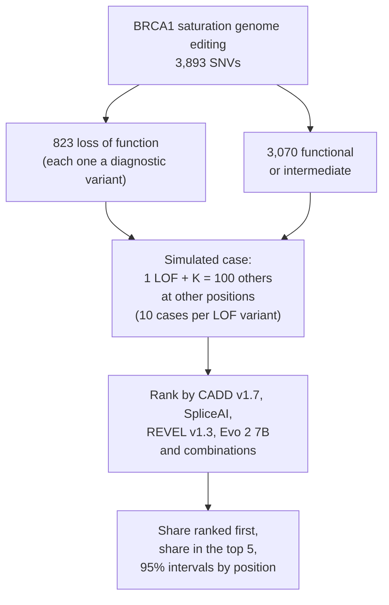
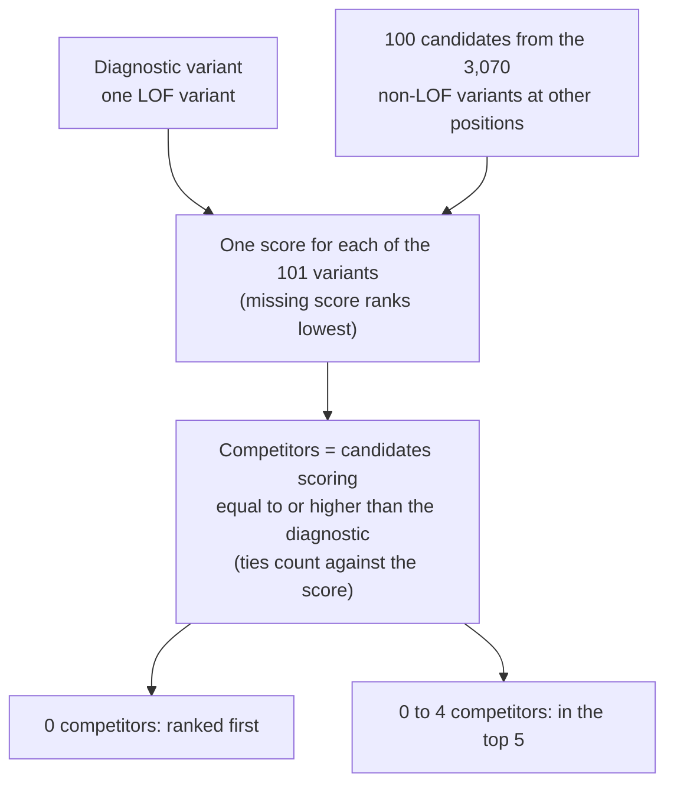
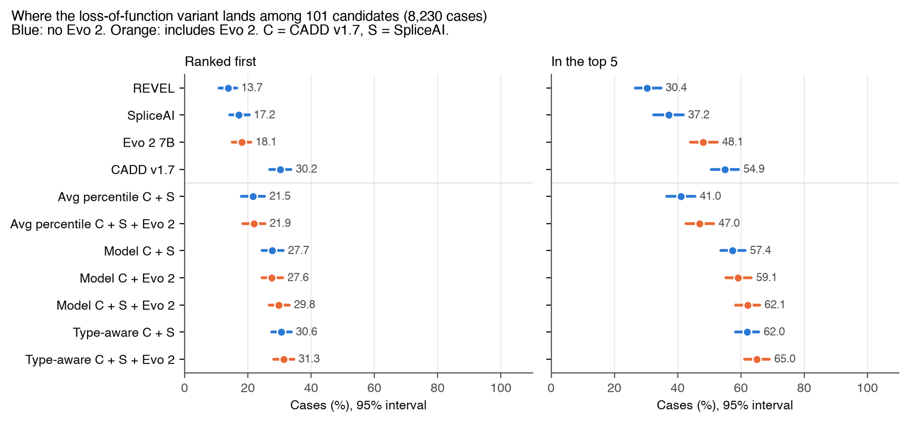
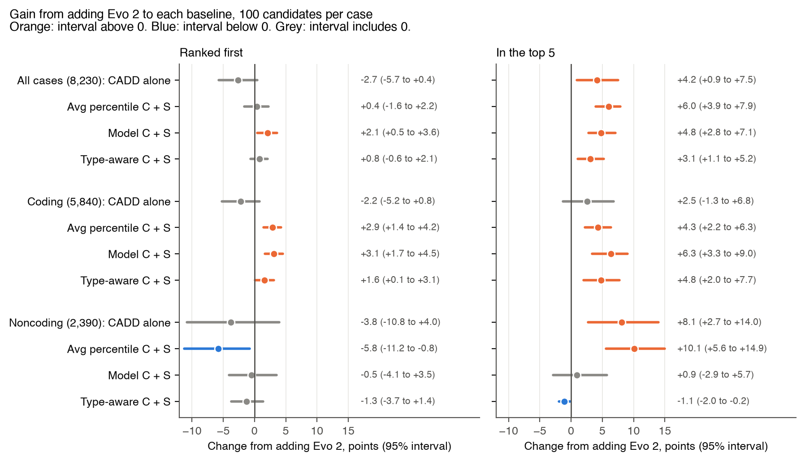
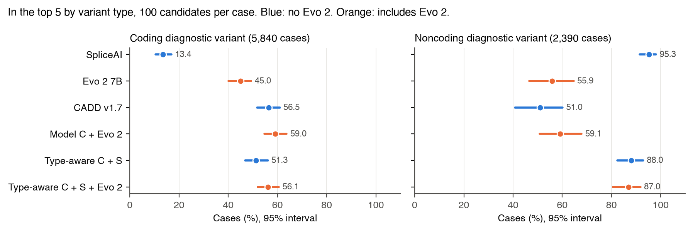

# BRCA1 case ranking

**Answer.** On one gene with lab assay labels, Evo 2 7B on its own ranks the loss-of-function variant below CADD
v1.7: in the top 5 of 101 candidates in 48.1% of cases (44.1 to 52.6) against 54.9% (50.6 to 59.3). Added to a
combination of CADD and SpliceAI it raises the top-5 rate by 3.1 points (1.1 to 5.2). That combination's coding
top-5 rate (51.3%) is below CADD alone (56.5%), though the two were not compared by a paired test. Against CADD alone
on coding variants, CADD + Evo 2 gives +2.5 points (-1.3 to 6.8), no gain detected. For noncoding variants, no
combination's point estimate reaches SpliceAI alone (95.3%); this was not tested. How the scores were combined moved
the top-5 rate more (41.0% to 62.0% without Evo 2) than adding Evo 2 did (+3.1 to +6.0 points). Seven of the 30
paired comparisons change significance with 20 candidates per case. All comparisons are exploratory.

Paper: [paper/paper.pdf](paper/paper.pdf). Method and file list: [README.md](README.md). Code:
[case_ranking.py](case_ranking.py). Every number: [results.json](results.json).

## Design

3,893 BRCA1 SNVs with saturation genome editing labels (Findlay et al. 2018). Each of the 823 loss-of-function
(LOF) variants is the diagnostic variant in 10 simulated cases, so there are 8,230 cases.



## How one case is scored



Combinations are logistic regressions, scored out of fold with 5-fold cross-validation grouped by position. The
"type-aware" model lets each score carry a different weight for coding and noncoding variants. A naive average of
percentiles is also shown, because it is what a first attempt might use.

## Charts







## Findings

100 candidates per case unless stated. Significant means the 95% interval excludes zero (no multiplicity
correction). Intervals for single rates are descriptive.

| Finding | Estimate | 95% interval | Significant |
|---|---:|---:|---|
| CADD v1.7 alone, in top 5 | 54.9% | 50.6 to 59.3 | Descriptive |
| Evo 2 7B alone, in top 5 | 48.1% | 44.1 to 52.6 | Descriptive (no paired test against CADD) |
| Type-aware CADD + SpliceAI + Evo 2, in top 5 | 65.0% | 61.2 to 69.0 | Descriptive |
| Adding Evo 2 to type-aware CADD + SpliceAI, top 5 | +3.1 points | 1.1 to 5.2 | Yes |
| Same, ranked first | +0.8 points | -0.6 to 2.1 | No |
| Adding Evo 2 to the average of percentiles, top 5 | +6.0 points | 3.9 to 7.9 | Yes |
| Coding: CADD + Evo 2 against CADD alone, top 5 | +2.5 points | -1.3 to 6.8 | No |
| Coding: adding Evo 2 to type-aware CADD + SpliceAI, top 5 | +4.8 points | 2.0 to 7.7 | Yes |
| Noncoding: adding Evo 2 to type-aware CADD + SpliceAI, top 5 | -1.1 points | -2.0 to -0.2 | Yes (a loss); reverses to a gain at 20 candidates (+0.6, 0.04 to 1.34) |
| Noncoding: SpliceAI alone, in top 5 | 95.3% | 91.5 to 98.1 | Descriptive |
| 20 candidates, coding: CADD + Evo 2 against CADD, top 5 | +1.5 points | 0.1 to 2.9 | Yes, nominal |

## What it means

- Evo 2 carries real signal: alone it puts the LOF variant in the top 5 in about half the cases.
- No gain over CADD alone was detected on coding variants, and no combination's point estimate reached SpliceAI
  alone on noncoding variants (not tested). Much of its gain on the combined model may make up for that model's
  lower coding point estimate than CADD.
- The gain tended to be larger on weaker baselines: +6.0 points on the average of percentiles against +3.1 on the
  type-aware model at 100 candidates; +11.9 against +0.9 at 20. The difference between gains was not tested, and on
  coding cases the order reversed (+4.3 against +4.8).
- Seven of the 30 paired comparisons change significance between 100 and 20 candidates per case, and two change
  sign. Single results here are not stable. A new score that only helps a weak combination says more about the combination. The rare-disease
  benchmarks that followed use all established scores, combined the same way, as the baseline.

## Limits

- One gene and one assay, with candidates from the same gene. Real cases hold rare variants across many genes.
- Assay labels, not clinical diagnoses.
- Noncoding LOF variants here are almost all splice variants, so the noncoding result is a splice result.
- No analysis plan was fixed in advance; 60 paired intervals without correction. All comparisons are exploratory.
- Intervals resample positions only. They hold the candidate draws and the fitted models fixed, so they understate
  total uncertainty.
- It measures ranking signal. It does not validate a diagnostic test.

## Reproduce

```sh
uv run --with pandas --with numpy --with scikit-learn \
  python brca1-case-ranking/case_ranking.py --study ../evo2-cloud-operations
bash brca1-case-ranking/paper/make_figures.sh
bash tools/paper/build.sh brca1-case-ranking/paper
```

Clone `rewire-bio/evo2-cloud-operations` next to this repository and check out commit `f8ae11c`. In that checkout
run `make inputs` (writes `data/derived/brca1_variants.tsv`) and
`uv run --frozen python followup/current_predictors.py --fetch` (needs tabix, curl, unzip and network access).
Confirm that `git diff evidence/current-predictors/sources.json` is empty. Then run the commands above from this
repository's root. A rerun on 2 November 2026 gave a byte-identical `results.json`.
