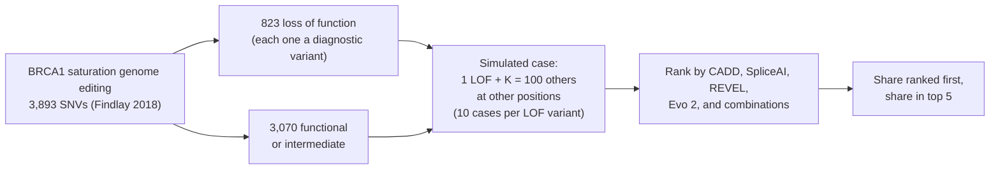

# BRCA1 case ranking

Does an Evo 2 7B zero-shot score help put the diagnostic variant near the top of a case's candidate list? This was
the talk's first case-level test, on one gene with lab assay labels. The rare-disease benchmark in
[`../rare-disease/`](../rare-disease/) replaced it with real backgrounds and ClinVar diagnoses; this study is on the
backup `bench-*` slides.



## Design

- **Data.** 3,893 BRCA1 SNVs with saturation genome editing labels (Findlay et al. 2018): 823 loss of function
  (LOF), 3,070 functional or intermediate. Evo 2 7B scores from the H100 run in
  `rewire-bio/evo2-cloud-operations`; CADD v1.7 raw, SpliceAI (largest masked delta) and REVEL v1.3 from the
  extracts that study fetches.
- **Cases.** Each LOF variant is the diagnostic variant in 10 simulated cases. Each case adds K candidates drawn
  from the functional or intermediate variants at other positions. K = 100 (headline) and K = 20.
- **Metrics.** Competitors = candidates scoring equal to or higher than the diagnostic variant (ties count
  against). Reported: diagnostic variant ranked first (0 competitors) and in the top 5 (at most 4).
- **Missing scores** rank lowest. REVEL scores missense variants only, so it fails every noncoding case.
- **Combinations** are logistic regressions on raw scores, out-of-fold from 5-fold cross-validation grouped by
  position. "Type-aware" models let each score carry a different weight for coding and noncoding variants.
- **Uncertainty.** 95% intervals from 1,000 resamples of diagnostic variants grouped by position.

## Files

| File | What it does |
|---|---|
| `case_ranking.py` | The benchmark; writes `results.json` |
| `results.json` | Every result: coverage, and per score and model the share ranked first and in the top 5, with intervals, for K = 100 and K = 20 |
| `liftover_brca1.py`, `fetch_avi.py` | Lift the variants to hg38 and fetch AlphaGenome AVI scores for them (below) |

`results.json` also includes a naive average-of-percentiles combination, shown on the backup "baseline" slide.
Adding it changed the random draws, so some intervals in `results.json` differ from the tables below in the third
significant figure. No point estimate changed.

## AlphaGenome AVI scores

`liftover_brca1.py` lifts the variants to hg38 and `fetch_avi.py` fetches AlphaGenome Atlas AVI scores for them
(key in `ALPHAGENOME_API_KEY`). Atlas outputs are non-commercial and are not committed.

## Results, K = 100

| Score | Ranked first | In top 5 (95% CI) |
|---|---:|---:|
| CADD v1.7 | 30.2% | 54.9% (50.6 to 59.3) |
| SpliceAI | 17.2% | 37.2% (32.4 to 41.8) |
| REVEL | 13.7% | 30.4% (26.6 to 34.7) |
| Evo 2 7B | 18.1% | 48.1% (44.1 to 52.6) |
| Type-aware CADD + SpliceAI | 30.6% | 62.0% (57.6 to 65.8) |
| Type-aware CADD + SpliceAI + Evo 2 | 31.3% | 65.0% (61.2 to 68.8) |

Adding Evo 2, paired differences in points (95% CI):

| Comparison | Diagnostic variant | Ranked first | In top 5 |
|---|---|---:|---:|
| Type-aware CADD + SpliceAI, then + Evo 2 | All | +0.8 (-0.6 to 2.1) | +3.1 (1.2 to 5.4) |
| Type-aware CADD + SpliceAI, then + Evo 2 | Coding | +1.6 (0.2 to 3.3) | +4.8 (2.1 to 7.7) |
| Type-aware CADD + SpliceAI, then + Evo 2 | Noncoding | -1.3 (-3.8 to 1.4) | -1.1 (-2.0 to -0.2) |
| CADD alone, then CADD + Evo 2 | Coding | -2.2 (-5.0 to 0.5) | +2.5 (-1.2 to 6.3) |

Best single score by type, in top 5: coding, CADD v1.7 56.5%; noncoding, SpliceAI 95.3%. The type-aware
combinations reach 51.3% (coding) and 88.0% (noncoding) without Evo 2, and 56.1% and 87.0% with it.

Reading:

1. On its own, Evo 2 ranks the LOF variant below CADD v1.7.
2. Added to the type-aware CADD + SpliceAI model, it puts the LOF variant in the top 5 in about 3 more cases
   per 100. But that model ranks coding cases below CADD alone, and much of the gain repairs this.
3. Against the best existing score for each variant type, no gain is detected: CADD + Evo 2 versus CADD alone
   for coding (+2.5 points, -1.2 to 6.3), and nothing beats SpliceAI alone for noncoding (splice) variants.
4. How scores are combined matters as much as which scores. A simple average of percentiles was worse than
   CADD alone overall. A new score that only helps a weak combination says more about the combination.

## Limits

One gene, assay labels rather than clinical diagnoses, and candidates drawn from the same gene's assay. Real
cases contain rare variants across many genes after frequency and consequence filters. This benchmark measures
ranking signal; it does not validate a diagnostic test. The logistic models are fitted on the same assay, with
position-grouped cross-validation.

## Run

```sh
uv run --with pandas --with numpy --with scikit-learn python brca1-case-ranking/case_ranking.py --study ../evo2-cloud-operations
```

Needs the study repository with `followup/current_predictors.py --fetch` already run. Per-variant scores are not
written out; CADD and the assay labels are licensed for non-commercial use.
