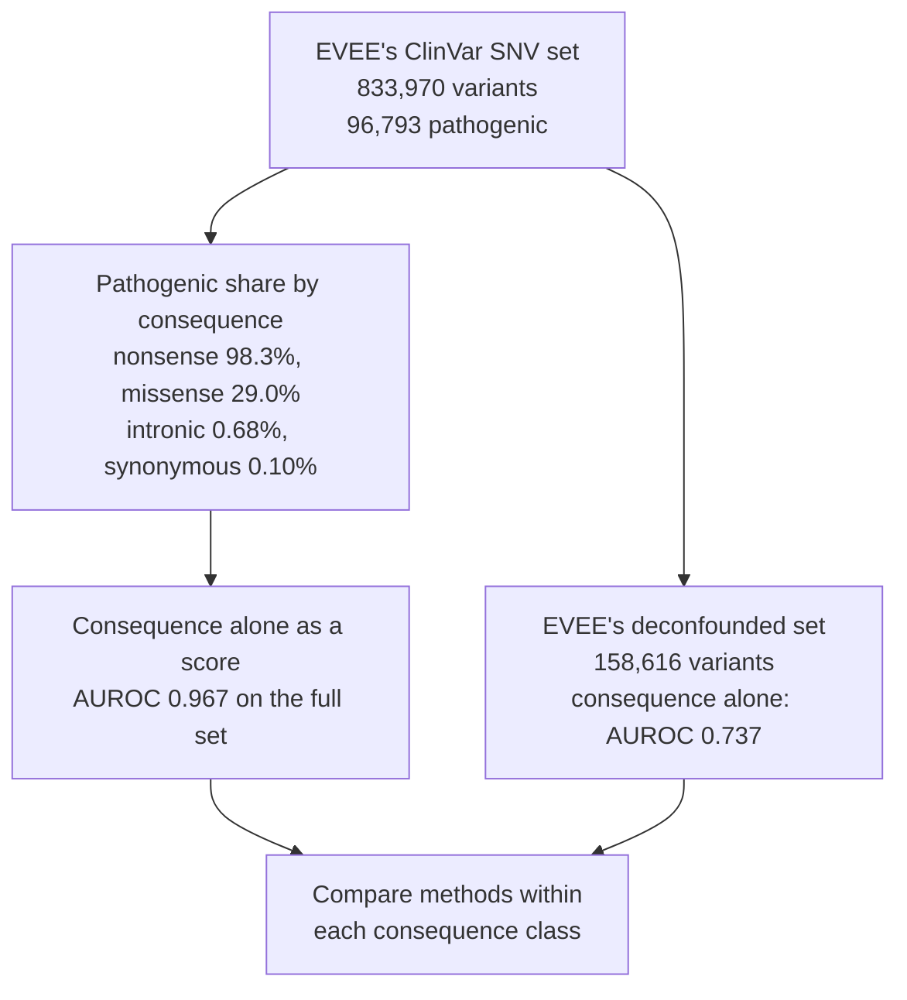
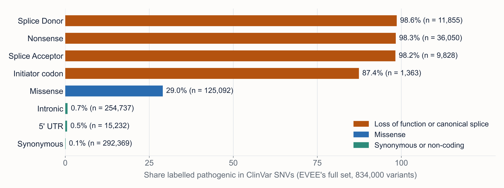
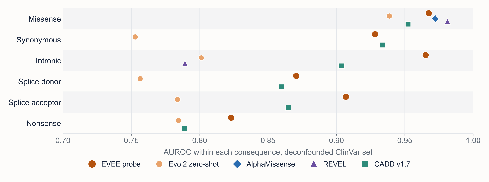
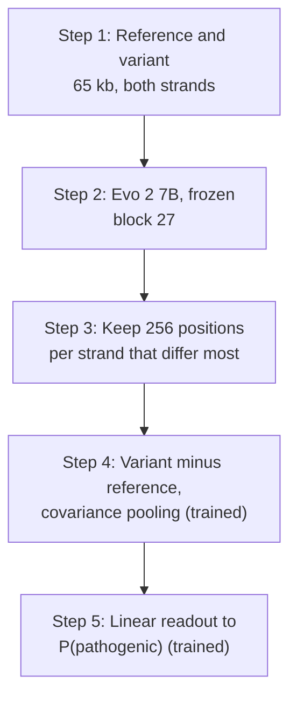

# EVEE charts: how much of a ClinVar AUROC is the consequence class?

**Answer.** Most of it. In EVEE's set of 833,970 ClinVar SNVs, a score that knows only a variant's consequence
class reaches an AUROC of 0.967 (95% interval 0.967 to 0.968). Headline AUROCs near 0.99 mostly measure that.
Within each class, AUROCs are lower and the order of methods changes: EVEE's probe leads CADD v1.7 clearly on
intronic variants, REVEL is higher on the missense variants it can score (36,783 of 125,092), and on EVEE's
deconfounded set EVEE's gaps to CADD v1.7 in the synonymous, splice and nonsense classes are within the approximate
intervals. This folder redraws two figures from the EVEE preprint (Pearce et al. 2026) for the talk, from the data
Goodfire released. We ran no model. Both charts show the published values exactly.

## The trap

## Within each consequence

Points where a method scored fewer than 100 variants are left out. The methods were scored on different subsets:
EVEE on 32,437 of the 158,616 deconfounded variants, CADD v1.7 on 158,607.

## How EVEE scores a variant

Steps 4 and 5 are trained on ClinVar SNV labels. Genes are split into five partitions, and each is scored by a
probe that never saw its genes (evee-manuscript README).

## Findings

All comparisons are exploratory. On the full set, "significant" means the published 95% intervals do not overlap, and
we apply this only between methods that scored the same variants (EVEE, Evo 2 zero-shot, CADD v1.7).
The deconfounded set has no published intervals; ours there are approximate (Hanley and McNeil) and we test nothing.

| Finding | Estimate | 95% interval | Significant? |
|---|---|---|---|
| Consequence alone as a score, full set | AUROC 0.967 | 0.967 to 0.968 | Not tested (descriptive) |
| Consequence alone as a score, deconfounded set | AUROC 0.737 | 0.735 to 0.739 | Not tested (descriptive) |
| Pathogenic share, nonsense against synonymous (full set) | 98.3% against 0.10% | 98.2 to 98.5; 0.09 to 0.11 | Not tested (descriptive) |
| EVEE against CADD v1.7, all SNVs | 0.9968 against 0.9914 | 0.9967 to 0.9970; 0.9911 to 0.9917 | Yes, but small |
| EVEE against CADD v1.7, intronic (full set) | 0.984 against 0.910 | 0.980 to 0.987; 0.900 to 0.918 | Yes |
| EVEE against CADD v1.7, nonsense (full set) | 0.900 against 0.783 | 0.885 to 0.914; 0.760 to 0.801 | Yes |
| EVEE against CADD v1.7, synonymous and splice acceptor (full set) | 0.961 against 0.929; 0.928 against 0.882 | overlapping | No |
| EVEE against REVEL, missense (full set, different subsets) | 0.971 against 0.978 | 0.970 to 0.972; 0.977 to 0.980 | Not comparable: REVEL scored only 36,783 of 125,092 |
| EVEE against CADD v1.7, intronic (deconfounded) | 0.965 against 0.904 | about 0.951 to 0.980; 0.893 to 0.915 | Not tested |
| EVEE against REVEL and AlphaMissense, missense (deconfounded) | 0.967 against 0.981 and 0.972 | about 0.9644 to 0.9706; 0.9793 to 0.9832; 0.9710 to 0.9736 | Not tested |
| Charts against the published tables | 21 of 21 markers, 8 of 8 labels match | | Check passed |

## What it means

A headline AUROC of 0.99 or more says little about how well a tool separates two missense variants, or two
intronic ones. The gap between EVEE and CADD v1.7 is 0.005 overall but 0.025 to 0.117 within a class. A lab
choosing a predictor should read its results within the consequence classes that matter for its cases, on the
variants the tool can actually score.

## Limits

- No new scores: every AUROC is EVEE's. The input files are read from a clone of goodfire-ai/evee-manuscript at
  commit `bb3bfa6` and are not in this repository.
- The deconfounded table has no intervals, and the methods were scored on different subsets. We do not know why
  EVEE was scored on only a fifth of that set but on every variant of the full set.
- The repository does not include the code behind the full-set intervals or the deconfounded selection, which its
  script calls "CADD-deconfounded".
- The probe is trained and tested on ClinVar labels (in held-out genes); CADD and Evo 2 zero-shot never saw them.

## Links

- [Paper (PDF)](paper/paper.pdf), with Methods, all tables and the full list of limits
- [README](README.md) for the chart commands
- Code: [chart script](evee_charts.py), [values and chart check](paper/stats.py) with output
  [stats.json](paper/stats.json), [figure build](paper/make_figures.sh)
- Source data: [goodfire-ai/evee-manuscript](https://github.com/goodfire-ai/evee-manuscript) and the preprint,
  [doi:10.64898/2026.04.10.717844](https://doi.org/10.64898/2026.04.10.717844)
