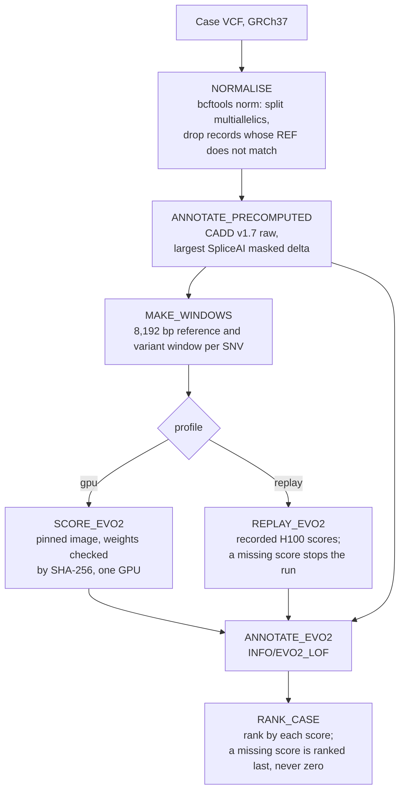
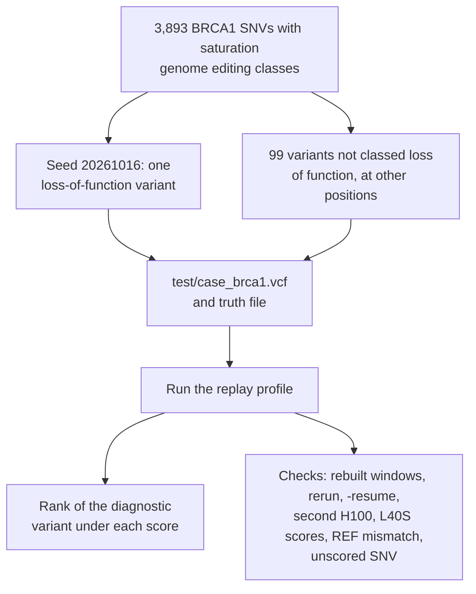
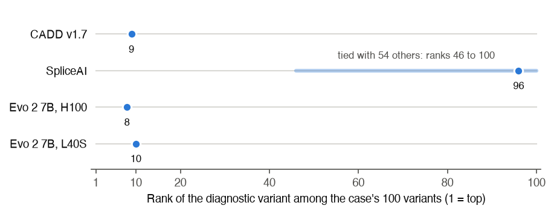
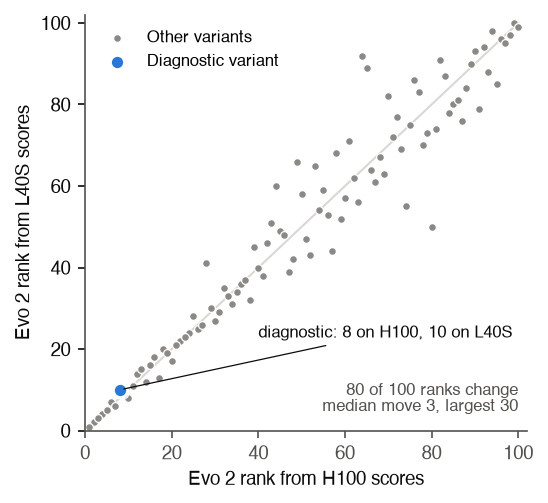
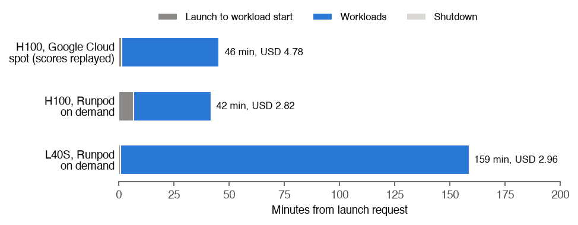

# Evo 2 case pipeline

**Answer.** Adding an Evo 2 7B score to a variant pipeline takes little code: this Nextflow pipeline does it in
about 350 lines, next to CADD v1.7 and SpliceAI. Its replay profile, which reads scores recorded on an H100, ran a
simulated 100-variant BRCA1 case end to end on a laptop in about 3 seconds, gave identical output when rerun, and
failed safely on bad input. The diagnostic missense variant ranked 8th by Evo 2, 9th by CADD and 96th by SpliceAI
(tied with 54 others at zero). The open problem is the GPU: scores from a second H100 were identical, but scores
from an L40S changed the Evo 2 rank of 80 of the 100 variants, by a median of 3 places (the top five did not
change; the diagnostic moved from 8th to 10th). Scoring a case this size takes about a minute of
H100 time. The gpu profile has not been run end to end through Nextflow. One case only: no finding here is a test
of which score is better.

Paper: [paper/paper.pdf](paper/paper.pdf). Method and file list: [README.md](README.md). Code:
[main.nf](main.nf), [nextflow.config](nextflow.config), [bin/](bin/). Every number:
[paper/run/summary.json](paper/run/summary.json), written by [paper/record_run.sh](paper/record_run.sh).

## The pipeline

Six processes run per case. The profile picks whether Evo 2 is computed on a GPU or replayed from a recorded run.

## How the test case works

## Charts

## Findings

One simulated case. No finding is tested for significance: a single case cannot show one score ranks better than
another, and the checks are pass or fail. The L40S comparison is exploratory. Intervals are given only where the
source study computed them.

| Finding | Estimate | Interval | Significant |
|---|---:|---:|---|
| Diagnostic variant's rank, Evo 2 7B (H100) | 8 of 100 | none (one case) | Not tested |
| Diagnostic variant's rank, CADD v1.7 | 9 of 100 | none (one case) | Not tested |
| Diagnostic variant's rank, SpliceAI | 96 of 100 | ties allow 46 to 100 | Not tested |
| Variants with all three scores | 100 of 100 | | Check passed |
| Pipeline windows equal the source study's windows | 198 of 198, same SHA-256 | | Check passed |
| Two fresh runs give the same ranked table | Yes, byte for byte | | Check passed |
| `-resume` reuses finished tasks | 6 of 6 cached | | Check passed |
| REF mismatch | 1 of 101 records dropped, run continues | | Check passed |
| SNV with no recorded score | Run stops, exit 1 | | Check passed |
| Second H100 (Runpod) scores | Identical ranked table | | Check passed |
| L40S against H100 scores, median difference | 1.01e-4 (largest 5.21e-4) | none | Exploratory |
| Evo 2 ranks changed by L40S scores | 80 of 100 (median move 3, largest 30; top five unchanged; diagnostic 8th to 10th) | none | Exploratory |
| H100 scoring rate (replayed run) | 2.93 windows per second | none | Descriptive |
| GPU time to score this case (198 windows) | about 68 s, about USD 0.08 on Runpod | estimate | Descriptive |
| Recorded cloud runs, 3,893 BRCA1 variants plus other workloads (completed attempts) | USD 2.82 to 4.78; a failed first L40S attempt cost USD 0.82 more | none | Descriptive |
| Context: Evo 2 7B minus CADD v1.7 AUROC, 3,893 BRCA1 SNVs (evo2-cloud-operations) | -0.006 | -0.025 to +0.014 | No |

## What it means

- The engineering is small. Apart from the GPU step, the pipeline is bcftools and two short Python scripts.
- Replaying recorded GPU scores lets the rest of the pipeline be tested on a laptop in seconds against the exact
  scores the GPU produced.
- The Evo 2 score depends on the GPU type. A lab should fix the GPU type and validate on it, or pay for full 32-bit
  precision, and record the GPU, image digest and weights with every score.
- Cost is not the obstacle for one case. Most of a single-case job is starting the machine and loading the model,
  so batching cases on a running GPU is cheaper.

## Limits

- The gpu profile has not been run end to end through Nextflow.
- One simulated case, in one gene, built from assay variants, on GRCh37 chromosome 17 only.
- SNVs only: indels get no Evo 2 score.
- Ties are broken by VCF order, so SpliceAI ranks for zero scores are close to arbitrary.
- The pipeline does not yet write the image digest or GPU into the VCF.
- Only the Evo 2 step runs in a pinned container. The CPU steps use the host's bcftools and python3, and
  `resources/` and the recorded scores are not checksummed.
- The L40S was about five times slower than the H100 on the recorded host, but 3.2 times slower on another host
  in the source study's follow-up, so speed depends on the host.
- Costs are from one day's runs at prices recorded at launch; per-case figures are estimates.
