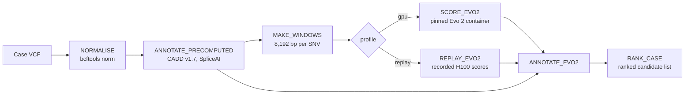

# Evo 2 case pipeline

A Nextflow DSL2 pipeline that adds an Evo 2 7B zero-shot score to a case's variants next to CADD and SpliceAI,
and ranks the case. Shown on the talk's `pipeline-overview` slide and the backup `code-*` slides.



The test case (`test/case_brca1.vcf`) is a simulated BRCA1 case on GRCh37; `test/case_brca1.truth.txt` names its
diagnostic variant.

| File | What it does |
|---|---|
| `main.nf` | The workflow and its seven processes |
| `nextflow.config` | The `replay` and `gpu` profiles |
| `bin/make_windows.py`, `bin/score_evo2.py`, `bin/replay_evo2.py`, `bin/rank_case.py` | The steps' Python code |
| `scripts/prepare_resources.py` | Builds `resources/` (reference, CADD and SpliceAI extracts, recorded scores) from `evo2-cloud-operations` |

```sh
cd evo2-pipeline
python3 scripts/prepare_resources.py --study ../../evo2-cloud-operations   # builds resources/ and test/
JAVA_HOME=/opt/homebrew/opt/openjdk@21 nextflow run main.nf -profile replay  # laptop, recorded Evo 2 scores
nextflow run main.nf -profile gpu                                             # GPU host with Docker
```

Needs Nextflow 24.10 or later (Java 17+), bcftools, tabix, bgzip and samtools. `resources/` is not committed:
CADD and the assay labels are licensed for non-commercial use. The replay profile has been run end to end; the gpu
profile uses the scoring code that produced the recorded H100 scores but has not been run end to end through
Nextflow on a GPU host.
