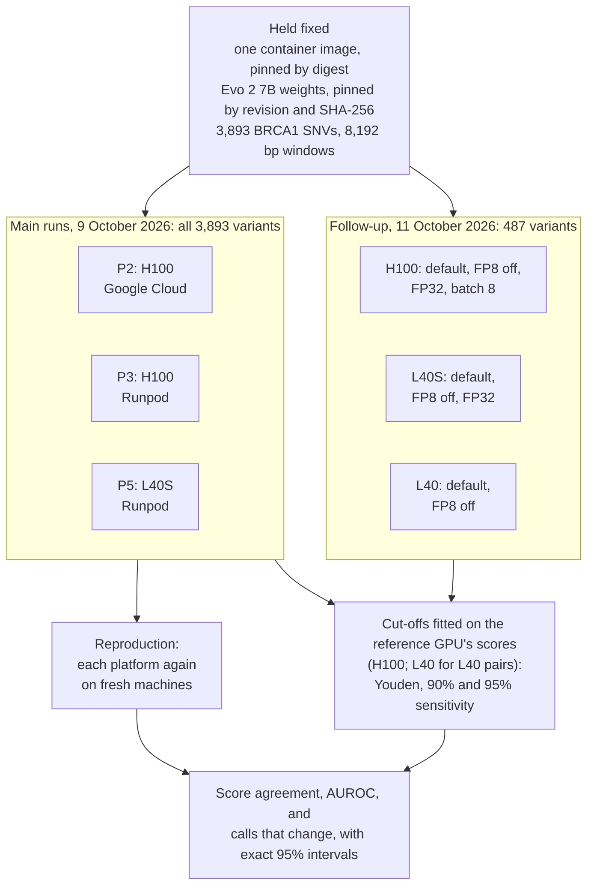
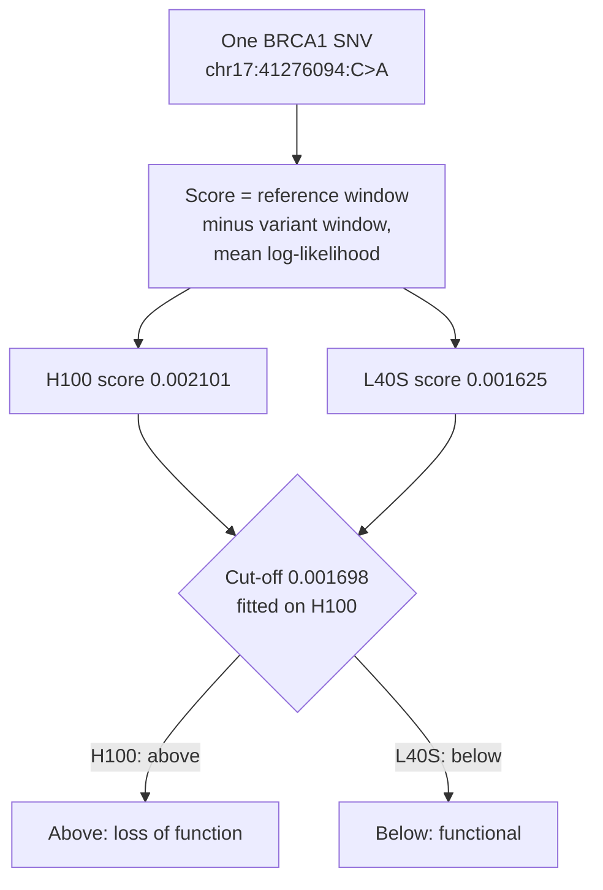
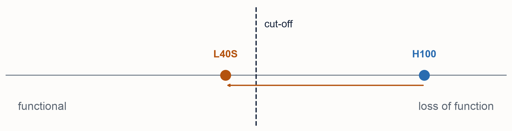
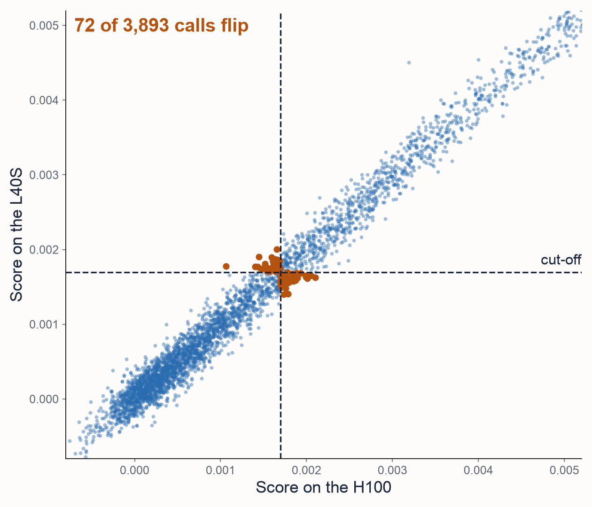
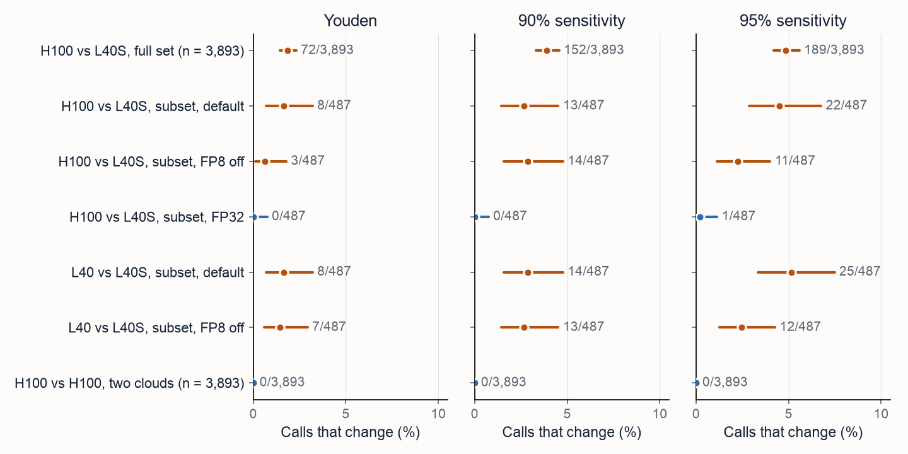
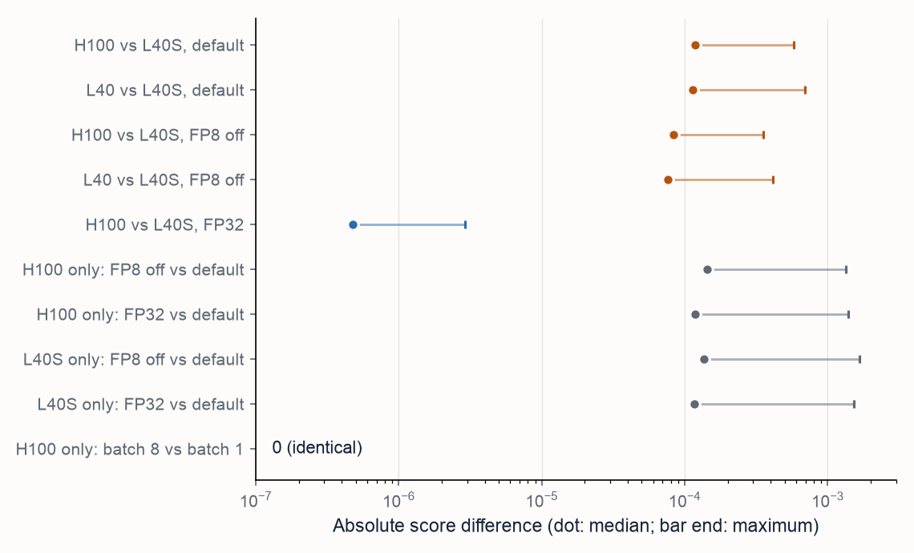

# GPU drift: do Evo 2 calls change between GPU models?

**Answer.** Yes, for borderline variants. The same container, Evo 2 7B weights and inputs scored 3,893 BRCA1 SNVs
on two H100 GPUs at two clouds and on an L40S. The two H100s gave bit-identical scores. The L40S scores differed by
a median of 1.17e-4, which moved AUROC by only 0.0021 (95% interval 0.0002 to 0.0042) but changed
72 of 3,893 calls (1.8%, 1.4% to 2.3%) at a cut-off fitted on the H100, and up to 189 (4.9%) at more
sensitive cut-offs. An L40 and an L40S, which share an architecture, disagreed as much. Computing in FP32 removed
almost all of the difference, at 3 to 6 times the GPU time. Fix the GPU product and validate on it, or compute in
FP32. The runs and the analysis are in
[rewire-bio/evo2-cloud-operations](https://github.com/rewire-bio/evo2-cloud-operations/tree/f8ae11c9a1c4); the
gpu-drift folder of this repository draws the charts and writes them up.

## Design

## How one call flips

The assay classes this missense variant as functional, so here the L40S happens to agree with it. Across all
variants, flips run both ways: 41 called loss of function on the H100 only, 31 on the L40S only.

## All variants

## Findings

| Finding | Estimate | 95% interval | Status |
|---|---|---|---|
| H100 vs H100 (two clouds), and each platform against its own rerun | 0 differences in 3,893 scores | none (exact equality) | Not a test: identical |
| H100 vs L40S, median score difference | 1.17e-4 (Spearman 0.983) | not computed | Descriptive |
| H100 vs L40S, AUROC difference (L40S minus H100) | 0.0021 | 0.0002 to 0.0042 | Yes, but too small to matter |
| Calls that change, Youden cut-off | 72 of 3,893 (1.8%) | 1.4% to 2.3% | Estimate (nonzero; controls 0) |
| Calls that change, 90% sensitivity cut-off | 152 of 3,893 (3.9%) | 3.3% to 4.6% | Estimate (nonzero; controls 0) |
| Calls that change, 95% sensitivity cut-off | 189 of 3,893 (4.9%) | 4.2% to 5.6% | Estimate (nonzero; controls 0) |
| Same-GPU controls, calls that change | 0 of 3,893 at every cut-off | 0.0% to 0.09% (exact) | Not a test: identical |
| Follow-up: FP8 off, H100 vs L40S median difference | 0.70 of default | not computed | Exploratory |
| Follow-up: FP32, H100 vs L40S median difference | 4.77e-7, about 250 times smaller | not computed | Exploratory |
| Follow-up: FP32, calls that change (Youden, 90%, 95%) | 0, 0 and 1 of 487 | 0.0% to 0.8%, 0.0% to 0.8%, 0.0% to 1.1% | Exploratory |
| Follow-up: L40 vs L40S median difference | 1.13e-4, about the same as H100 vs L40S (1.19e-4) | not computed | Exploratory |
| Follow-up: batch 8 vs batch 1 on the H100 | 0 differences | none (exact equality) | Exploratory |
| Follow-up: FP32 GPU time | 5.8 times slower on H100, 3.4 on L40S | not computed | Exploratory |

## What it means

- The GPU model is part of the method. Validate Evo 2 on the GPU product that will run it, and revalidate when it
  changes. The same architecture is not enough.
- Arc's forward test passed on every GPU, so it does not catch this.
- A call hides how close a variant was to the cut-off. Here 150 to 334 of 3,893 variants sat within one median GPU
  difference of a cut-off. Report a margin.
- If scores must depend as little as possible on the hardware, compute in FP32 and pay 3 to 6 times the GPU time.

## Limits

- The cut-offs were fitted and applied on the same assay data. They are for counting flips, not clinical use.
- One gene, one model size (7B), one window length and three GPU products. Flip rates depend on how many variants sit
  near the cut-off.
- Same-model identity was shown for the H100 only.
- The follow-up used 487 variants, one machine per GPU, and was exploratory.
- The cause is inferred, not traced. The L40 and L40S have the same architecture and the same number of
  multiprocessors (142), and in the follow-up ran one image on one driver, so cuBLAS's conditions for identical
  results were met. Other kernels whose choice depends on the device (Transformer Engine, flash attention, Triton)
  are the likely source.
- Exact intervals treat variants as independent. Flips cluster slightly (189 flips at 165 positions at the 95%
  cut-off), so the intervals may be a little narrow.

## Read more

- [Paper (PDF)](paper/paper.pdf), built from [paper/paper.md](paper/paper.md)
- [README](README.md)
- Code: [flip_charts.py](flip_charts.py) (slide charts) and [paper/make_figures.py](paper/make_figures.py) (paper
  charts)
- Runs and analysis:
  [evo2-cloud-operations](https://github.com/rewire-bio/evo2-cloud-operations/tree/f8ae11c9a1c4), including
  [CLASSIFICATION-FLIPS.md](https://github.com/rewire-bio/evo2-cloud-operations/blob/f8ae11c9a1c4/followup/CLASSIFICATION-FLIPS.md)
  and [RESULTS.md](https://github.com/rewire-bio/evo2-cloud-operations/blob/f8ae11c9a1c4/followup/RESULTS.md)
