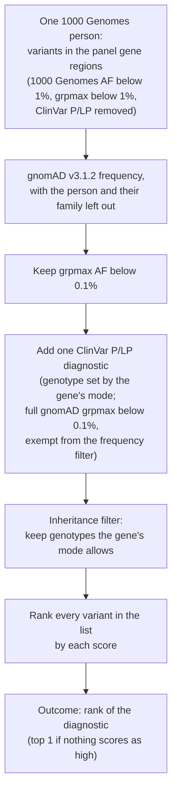
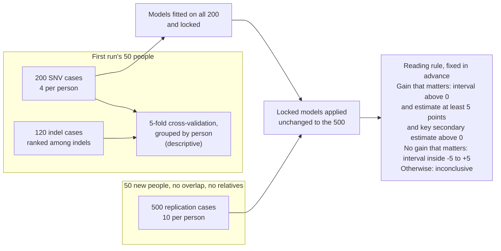
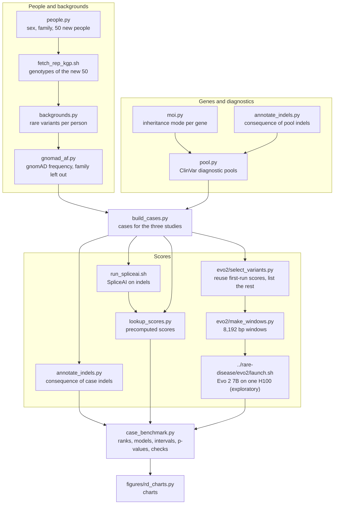
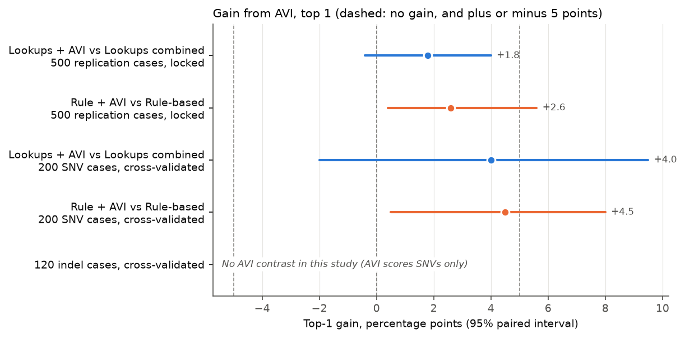
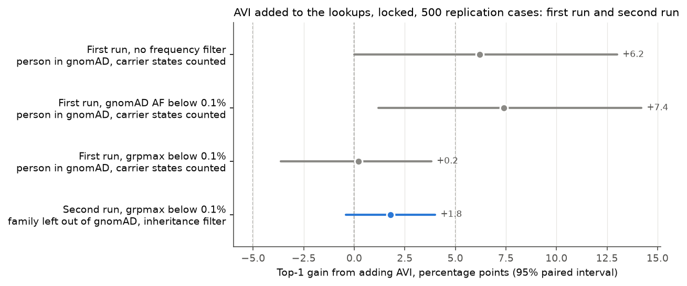
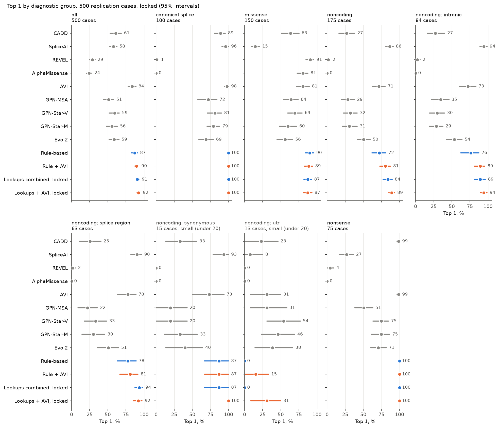
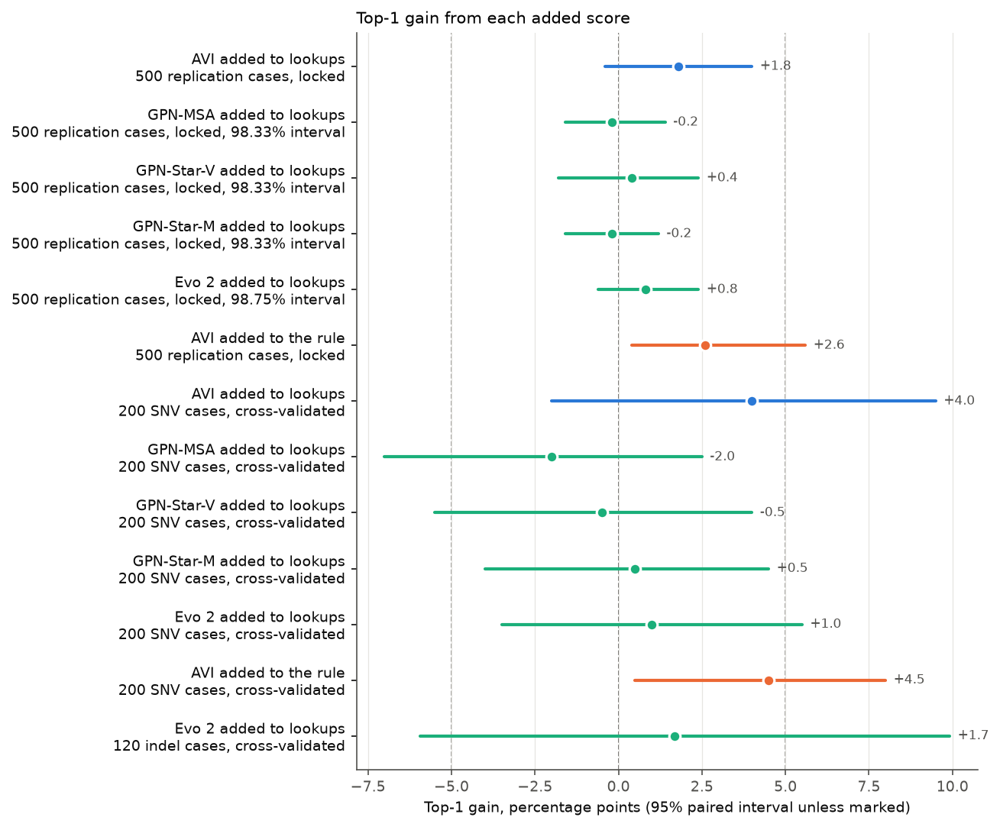
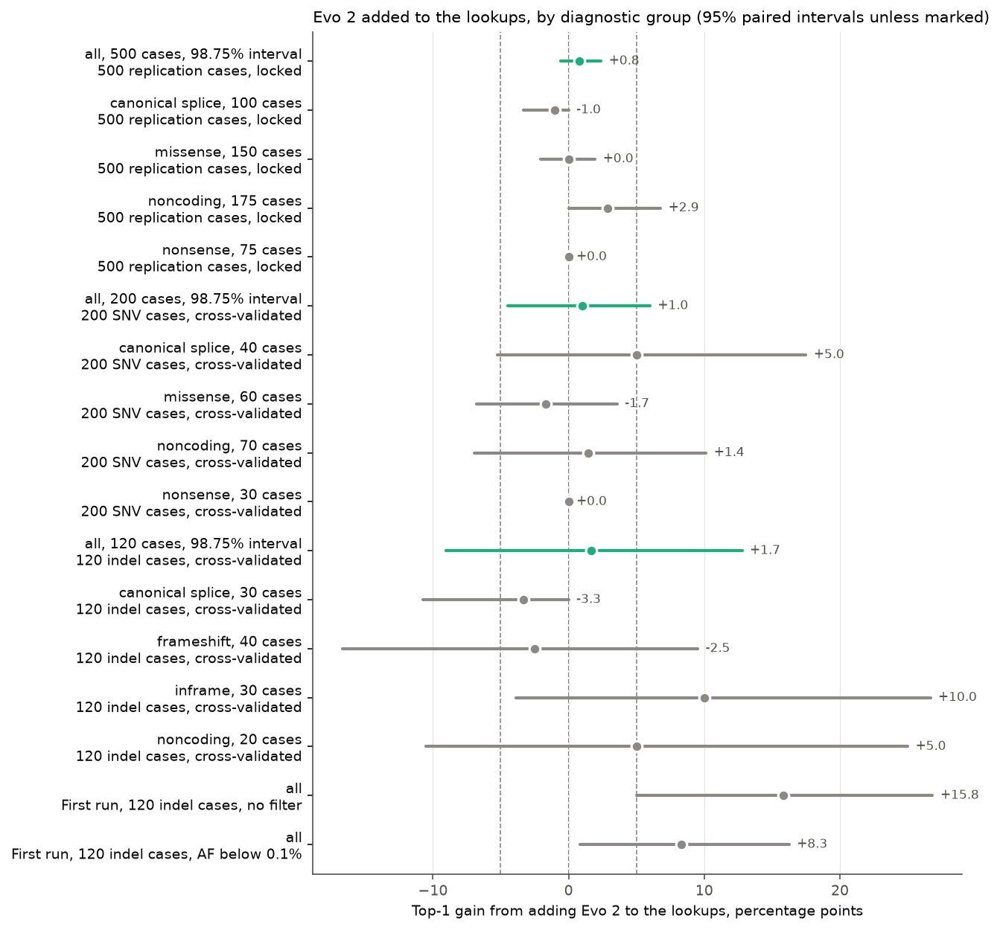
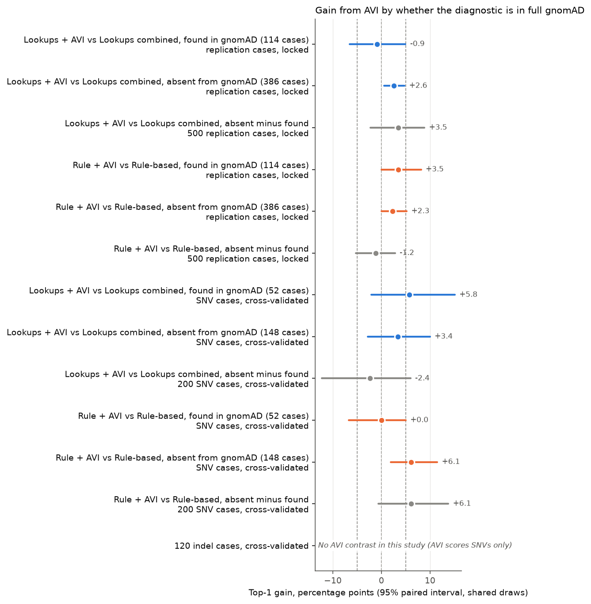

# Rare-disease case tests, second run

> With gnomAD frequencies that leave out each person's family, a grpmax filter and an inheritance filter, adding
> AlphaGenome AVI to the established lookups does not raise top 1 by a gain that matters on 500 new cases: +1.8
> points (-0.4 to +4.0). The lookups alone rank the diagnostic variant first in 90.6% of cases (87.8 to 93.4).
> GPN-MSA and GPN-Star add nothing on SNVs. Evo 2 adds no gain that matters on the 500 SNV cases; on indels its
> top-1 result is inconclusive.

The full write-up is the [paper (PDF)](paper/paper.pdf). Every number is in the [README](README.md) and the
[result files](results/README.md); the design is in [`PROTOCOL.md`](PROTOCOL.md). Results with Evo 2 will be released as
tag `amp-2026-v6`; `amp-2026-v5` holds the same results without Evo 2.

## The answer

| Question | Answer | Level |
|---|---|---|
| Q1. Does AVI added to the lookups raise top 1 on the 500? (primary) | No gain that matters: +1.8 (-0.4 to +4.0), p = 0.162 | 95%, reading rule fixed in advance |
| Q2. How often do the lookups alone rank the diagnostic first? | 90.6% (87.8 to 93.4); a rule-based ranking 87.2% (82.8 to 91.0) | 95%, descriptive |
| Q3. Does AVI help the rule-based ranking? | A little: +2.6 (+0.4 to +5.6), p = 0.034, under the 5-point smallest gain of interest | 95%, key secondary |
| Q4. Do GPN-MSA or GPN-Star add anything? | No: GPN-MSA -0.2 (-1.6 to +1.4), GPN-Star-V +0.4 (-1.8 to +2.4), GPN-Star-M -0.2 (-1.6 to +1.2) | 98.33%, Bonferroni over 3 |
| Does Evo 2 add anything? | No gain that matters on the 500 SNV cases: +0.8 (-0.6 to +2.4). Inconclusive on the 120 indel cases: +1.7 (-9.0 to +12.8) | 98.75%, exploratory |

Gains are top-1 percentage points with paired bootstrap intervals over people.

## How a case is built

One 1000 Genomes person's rare variants in the genes of [PanelApp panel 285, Intellectual disability](https://panelapp.genomicsengland.co.uk/panels/285/) (v11.45, about 1,510 genes; diagnostics from 348 of them), plus one inserted ClinVar
pathogenic variant. Each score ranks the list; the outcome is where the diagnostic lands.

## The design

## The pipeline

## Key charts

Gain from AVI at top 1, 95% paired intervals. Blue: AVI added to the lookups. Orange: AVI added to the rule. Dashed
lines at -5, 0 and +5 points.

The first run's +6.2 (0.0 to +13.0) used gnomAD frequencies that included the background people themselves and
counted carrier states as diagnoses. Under its grpmax filter the gain was already +0.2 (-3.6 to +3.8); this run gives +1.8 (-0.4 to +4.0).

Top 1 by diagnostic group on the 500. The rankings tie on canonical splice and nonsense; they differ on non-coding
diagnostics.

Every added score, top-1 gain. GPN rows on the 500 have 98.33% intervals, Evo 2 rows on the 500 98.75%.

Evo 2 by group in each study, with the first run's indel gains (+15.8, +5.0 to +26.8, unfiltered; +8.3, +0.9 to
+16.3, with an AF filter) at the bottom. The "all" rows have 98.75% intervals.

AVI's gain in cases whose diagnostic is in gnomAD and in cases where it is not. Nothing is flagged on the 500.

## Findings

| Finding | Result | Level | Significant | Matters |
|---|---|---|---|---|
| AVI added to the lookups, 500 locked (primary) | +1.8 (-0.4 to +4.0), p = 0.162 | Primary, 95%, reading rule | No | No gain that matters |
| AVI added to the rule, 500 (key secondary) | +2.6 (+0.4 to +5.6), p = 0.034 | Key secondary, 95%, unadjusted; no test pre-specified | Excludes zero; not a pre-specified test | Inconclusive |
| Lookups minus rule, 500 | +3.4 (0.0 to +7.4), p = 0.054 | 95%, descriptive (1 of 141) | No | Inconclusive |
| Lookups minus rule, non-coding diagnostics | +12.0 (+4.7 to +20.9), p = 0.001 | 95%, descriptive (1 of 141) | Yes | Yes, in this group |
| AVI added to the lookups, non-coding diagnostics | +5.1 (+0.6 to +10.5), p = 0.030 | 95%, descriptive (1 of 141) | Yes | Yes, in this group |
| GPN-MSA, GPN-Star-V, GPN-Star-M added, 500 | -0.2 (-1.6 to +1.4); +0.4 (-1.8 to +2.4); -0.2 (-1.6 to +1.2) | 98.33%, Bonferroni over 3 | No | No |
| Evo 2 added, 500 SNV locked | +0.8, 98.75% (-0.6 to +2.4), p = 0.236 | 98.75%, exploratory | No | No |
| Evo 2 added, 200 SNV | +1.0, 98.75% (-4.5 to +6.0), p = 0.760 | 98.75%, exploratory | No | Inconclusive |
| Evo 2 added, 120 indel, top 1 | +1.7, 98.75% (-9.0 to +12.8), p = 0.746 | 98.75%, exploratory | No | Inconclusive |
| Evo 2 added, 120 indel, top 5 | +4.2, 98.75% (+0.8 to +9.5), p = 0.012 | 98.75%, exploratory, top 5 descriptive | Yes | Inconclusive |
| EVEE alone against the lookups, ClinVar-covered lists | 87.0 (82.5 to 90.9) against 87.0 (82.2 to 91.0) | 95%, descriptive only | Not tested | Agreement with ClinVar labels, not performance |

"Significant": the interval at the stated level excludes zero. "Matters": Yes if significant and the estimate is at
least 5 points; No if the interval lies inside -5 to +5; otherwise Inconclusive. Only the primary has a verdict. "1 of 141": one of 141 paired top-1 contrasts in the 500's main result file; the 16 result files
hold 944, so some descriptive intervals will exclude zero by chance.

## What it means

- With a realistic pipeline the established lookups rank the diagnostic first in about 9 cases in 10.
- A rule-based ranking from ClinGen thresholds does nearly as well; it is weaker only on non-coding diagnostics.
- AVI helps a little with non-coding diagnostics, and not by a gain that matters overall.
- GPN-MSA and GPN-Star add nothing on SNVs. Evo 2 adds no gain that matters on the 500 SNV cases, and its top-1
  result on indels is inconclusive. Evo 2 alone ranks indels well (81.7% top 1, 73.7 to 89.2), close to the lookups
  combined (84.2%, 75.4 to 92.4), so adding it gains little.
- The first run's headline gains for AVI (+6.2, 0.0 to +13.0) and for Evo 2 on indels (+15.8, +5.0 to +26.8) do not
  hold under this design: +1.8 (-0.4 to +4.0) and +1.7 (95%: -5.9 to +9.9) here.

## Limits

- Short lists: a median of 19 SNVs on the 500 and 4 indels on the 120, after the filters.
- The lookups are near the ceiling at 90.6% top 1 (87.8 to 93.4), so little room is left for any added score.
- Consequence comes from MANE Select only. Genomics England's pipeline uses every GENCODE Basic transcript, and calls
  a variant high or moderate impact if any basic transcript does
  ([Genomics England, predicted functional impact](https://pipeline-rd-help.genomicsengland.co.uk/latest/variant-prioritisation-approaches/small-variant-tiering/predicted-functional-impact/)).
  Some variants would change group, class or rule tier.
- Diagnostics in biallelic genes are homozygous; compound heterozygous diagnoses are not modelled.
- Many ClinVar diagnostics were classified with the same lookups, which favours the lookups and both baselines.
- Most diagnostics are absent from gnomAD while almost every background variant is present. The split check
  flags no gain on the 500; on the 200 it flags the key secondary in one check.
- Evo 2 was added after the other results were seen, so it is exploratory.

More in the [README](README.md#limits) and the [paper](paper/paper.pdf).

## Links

- [Paper (PDF)](paper/paper.pdf)
- [README: the full write-up with every number](README.md)
- [Protocol](PROTOCOL.md) and [proposal](PROPOSAL.md)
- [Results on the 500](results/analysis_replication.md) and [on the 200 and 120](results/analysis_snv_indel.md)
- [Code, data and results](https://github.com/rewire-bio/amp-2026-studies/tree/main/rare-disease-v2)
- [The first run](../rare-disease/README.md)
