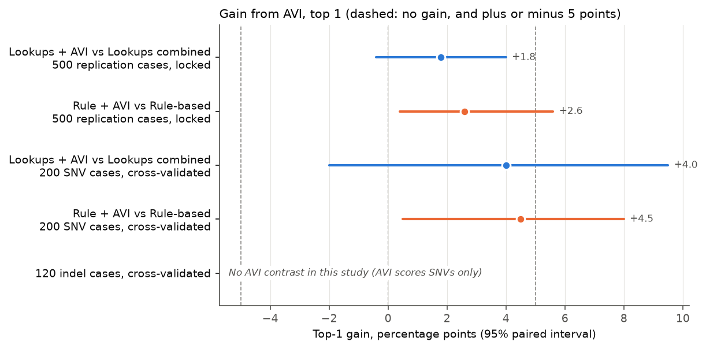
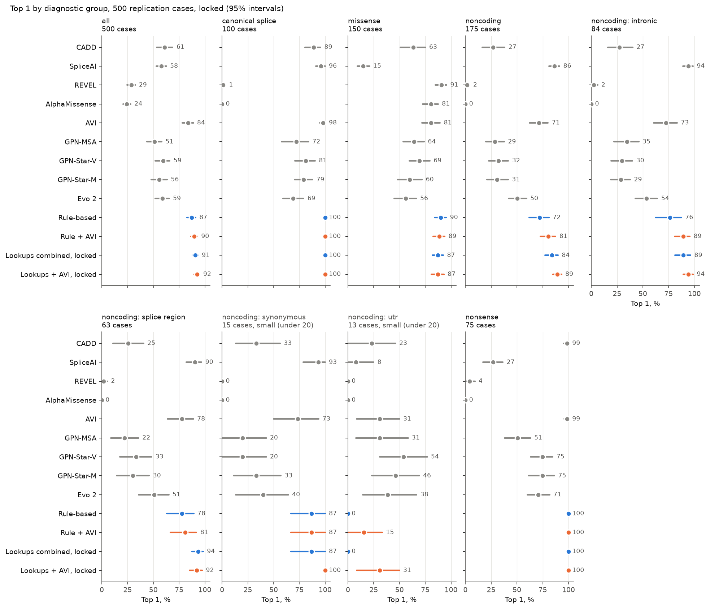
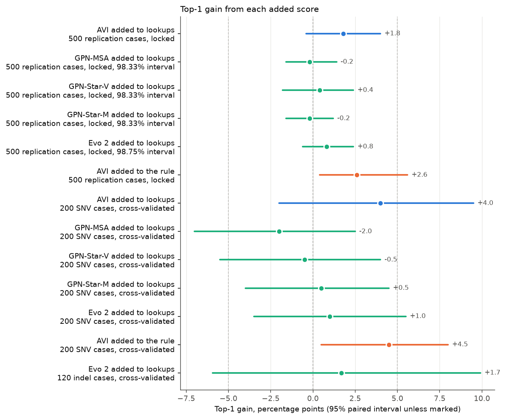
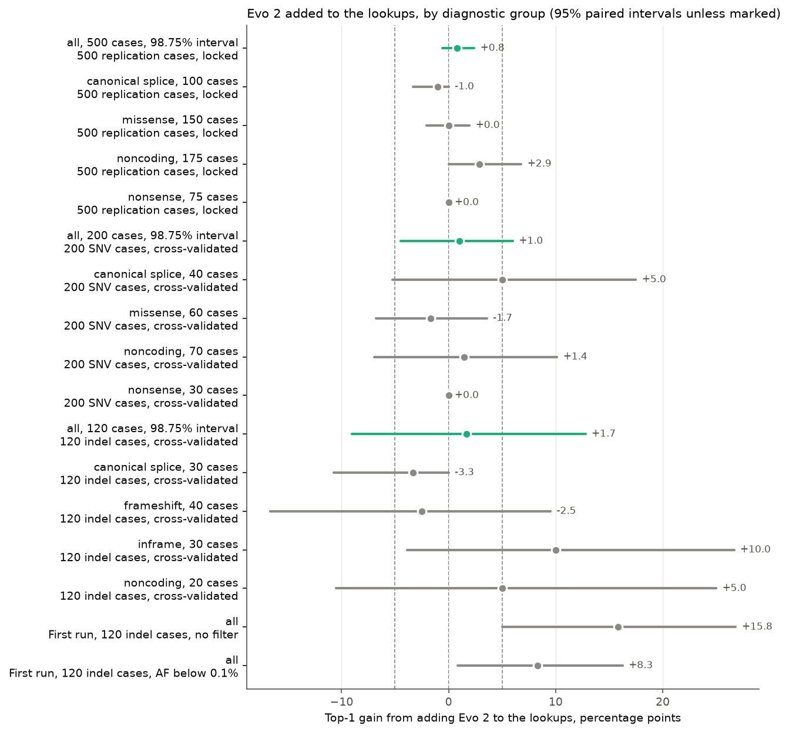
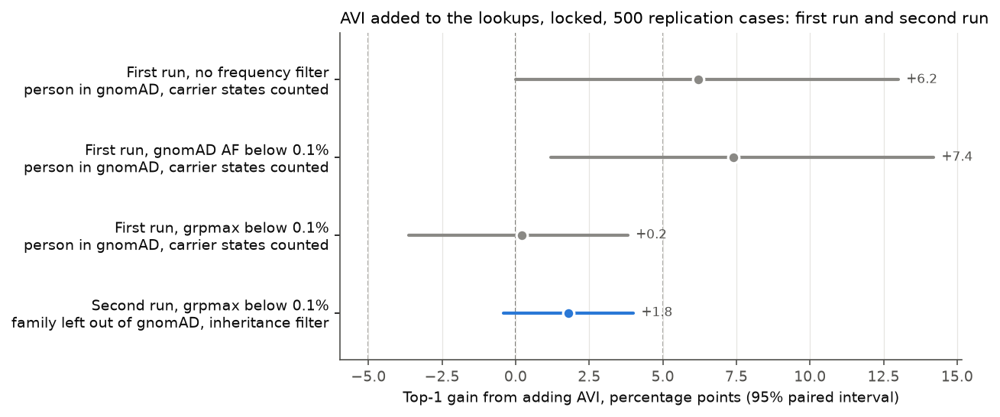
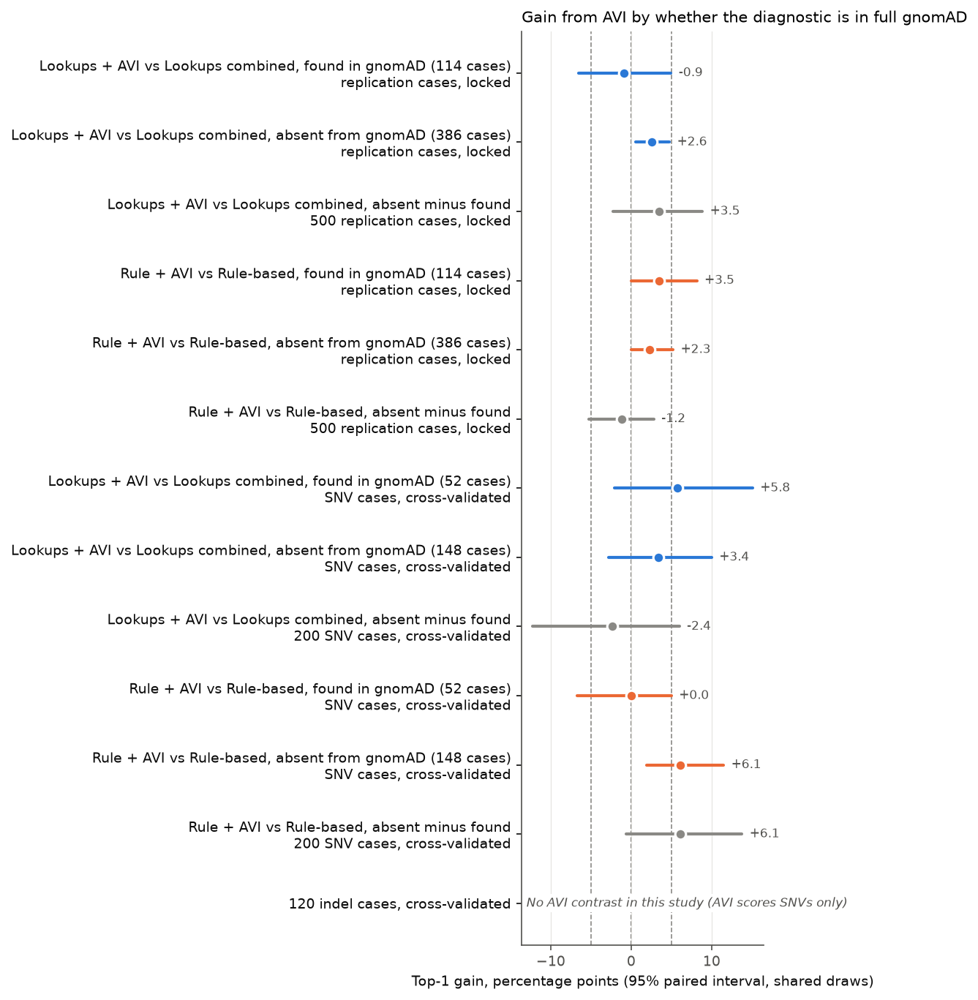
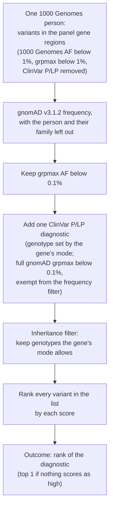
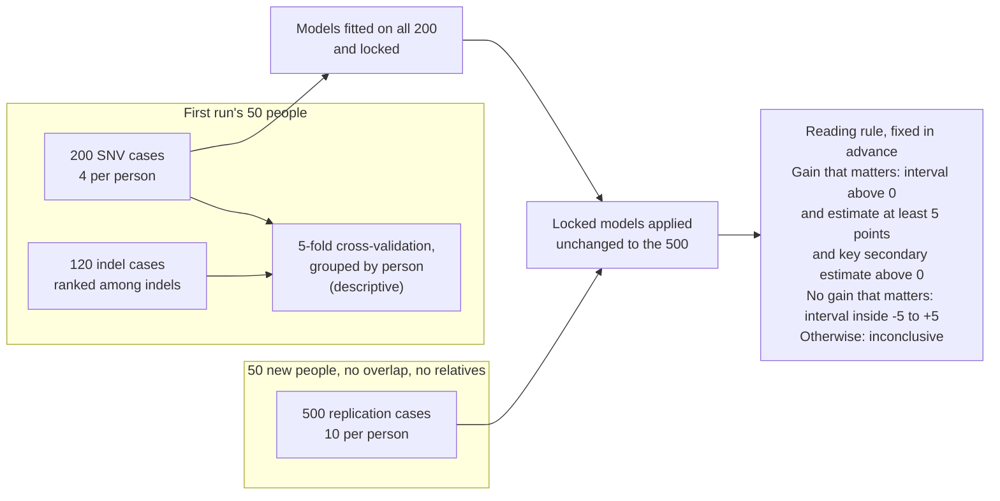
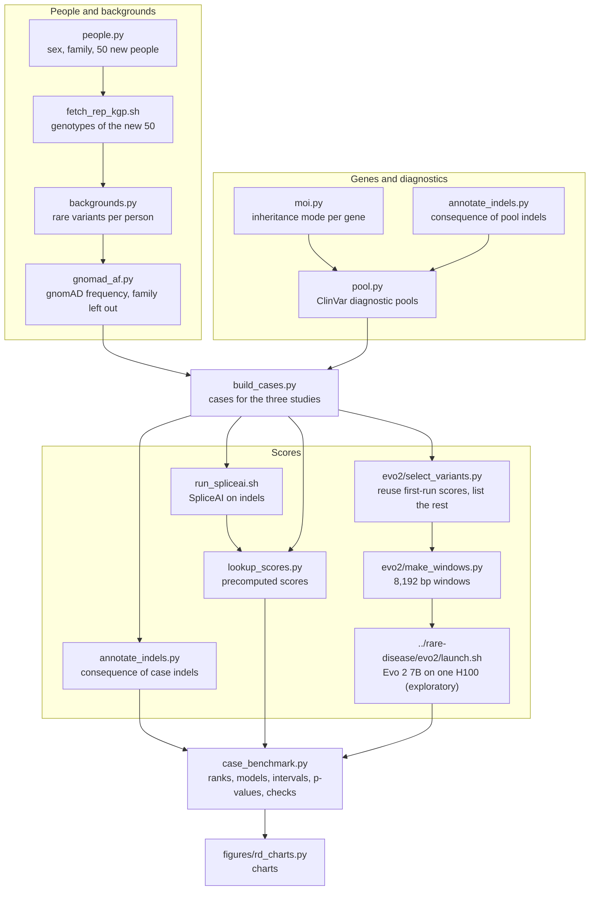

# Rare-disease case tests, second run

With gnomAD frequencies that leave out each person's family, a grpmax filter and an inheritance filter, adding
AlphaGenome AVI to the established lookups does not raise top 1 by a gain that matters on 500 new cases: +1.8 points
(-0.4 to +4.0). The lookups alone rank the diagnostic variant first in 90.6% of cases (87.8 to 93.4), and a simple
rule-based ranking from ClinGen thresholds reaches 87.2% (82.8 to 91.0). AVI helps a little with non-coding
diagnostics. GPN-MSA and GPN-Star add nothing on SNVs. Evo 2 adds no gain that matters on the 500 SNV cases, and
its top-1 result on indels is inconclusive. The first
run's AVI gain (+6.2, 0.0 to +13.0) and its Evo 2 indel gain (+15.8, +5.0 to +26.8) do not hold under this design.

This is a second run of the rare-disease case tests in [`../rare-disease/`](../rare-disease/), on the intellectual
disability panel only: [PanelApp panel 285, Intellectual disability](https://panelapp.genomicsengland.co.uk/panels/285/) (version 11.45, about 1,510 green genes; the diagnostic variants come from 348
of them). It fixes the problems found in review of the first run
([issue #1](https://github.com/rewire-bio/amp-2026-studies/issues/1),
[issue #2](https://github.com/rewire-bio/amp-2026-studies/issues/2)): the 1000 Genomes background people are in
gnomAD, the realistic grpmax filter was only a side check, about half the diagnoses were carrier states, the combined
model was a weak baseline within each variant type, two consequence annotations were mixed, and not every gain had a
paired interval.

Status: done, 2 November 2026, including Evo 2 on every case.

- Paper: [`paper/paper.pdf`](paper/paper.pdf)
- Visual companion: <https://rewire-bio.github.io/amp-2026-studies/rare-disease-v2/> (source
  [`COMPANION.md`](COMPANION.md))
- Release tags: `amp-2026-v5` holds every result without Evo 2. This version, with Evo 2, will be released as
  `amp-2026-v6`. Every value not involving Evo 2 is identical between the two (checked on all 16 result files).

| Document | What it holds |
|---|---|
| [`PROPOSAL.md`](PROPOSAL.md) | Why the rerun, the questions, scope, smallest gain of interest, cost and risks |
| [`PROTOCOL.md`](PROTOCOL.md) | The design, Evo 2 (section 12), the frequency sweep (section 13) and the deviation log (section 14) |
| [`PLAN.md`](PLAN.md) | The work, as phases and tasks |
| [`results/analysis_replication.md`](results/analysis_replication.md) | The 500 replication cases, locked: the primary result and every check |
| [`results/analysis_snv_indel.md`](results/analysis_snv_indel.md) | The 200 SNV and 120 indel cases, cross-validated (descriptive) |
| [`results/README.md`](results/README.md) | Every result file and field |
| [`data/README.md`](data/README.md) | Every data file, the Evo 2 files, and what is not committed |

## Findings

All figures are top 1 (the share of cases where the diagnostic variant ranks first), in percent, or gains in
percentage points, with bootstrap intervals over people and a two-sided bootstrap p-value for each paired gain. The
500 replication cases use models fitted on the 200 SNV cases and locked; the 200 and 120 are cross-validated.

How to read the level of each finding:

- Primary: 95% paired interval, read by a rule fixed in advance with a smallest gain of interest of 5 points. "A gain
  that matters": interval above 0, estimate at least 5, and the key secondary points the same way. "No gain that
  matters": interval inside -5 to +5. Otherwise inconclusive.
- GPN-MSA, GPN-Star-V and GPN-Star-M: Bonferroni-adjusted 98.33% interval (a family of three, pre-specified).
- Evo 2: Bonferroni-adjusted 98.75% interval (over four added scores). Exploratory, because it was added after
  every other result had been seen.
- Everything else: unadjusted 95% intervals, descriptive. There are many of them: `replication_main.json` holds 141
  paired top-1 contrasts (groups and the gnomAD split included; the filter checks are in their own files), `snv_main.json` 78 and `indel_main.json` 14. The
  16 result files hold 944, of which 175 have p below 0.05. If there were no real differences, at most about 47 would
  fall below 0.05 by chance (many contrasts are exactly zero in every resample and cannot).

"Significant" below means the interval at the stated level excludes zero; an interval that ends at 0.0 does not.
"Matters" applies the 5-point rule to each row: Yes if the row is significant and the estimate is at least 5; No if
the interval lies inside -5 to +5; otherwise Inconclusive. Only the primary has a verdict under the reading rule;
for other rows it describes the estimate.

| Finding | Result | Level | Significant | Matters |
|---|---|---|---|---|
| Q1. AVI added to the lookups combined, 500 locked (primary) | +1.8 (-0.4 to +4.0), p = 0.162 | Primary, 95%, reading rule | No | No: interval inside -5 to +5, "no gain that matters" |
| Q3. AVI added to the rule-based ranking, 500 (key secondary) | +2.6 (+0.4 to +5.6), p = 0.034 | Key secondary, 95%, unadjusted; no test pre-specified | Excludes zero; not a pre-specified test | Inconclusive |
| Q2. Lookups combined (locked) minus rule-based, 500 | +3.4 (0.0 to +7.4), p = 0.054 | 95%, descriptive (1 of 141) | No | Inconclusive |
| Q2. The same, non-coding diagnostics (175) | +12.0 (+4.7 to +20.9), p = 0.001 | 95%, descriptive (1 of 141) | Yes | Yes, in this group |
| Q4. GPN-MSA added to the lookups, 500 locked | -0.2, 98.33% (-1.6 to +1.4), p = 0.844 | 98.33%, Bonferroni over 3 | No | No |
| Q4. GPN-Star-V added to the lookups, 500 locked | +0.4, 98.33% (-1.8 to +2.4), p = 0.666 | 98.33%, Bonferroni over 3 | No | No |
| Q4. GPN-Star-M added to the lookups, 500 locked | -0.2, 98.33% (-1.6 to +1.2), p = 0.886 | 98.33%, Bonferroni over 3 | No | No |
| Evo 2 added to the lookups, 500 SNV cases locked | +0.8, 98.75% (-0.6 to +2.4), p = 0.236 | 98.75%, exploratory | No | No |
| Evo 2 added to the lookups, 200 SNV cases | +1.0, 98.75% (-4.5 to +6.0), p = 0.760 | 98.75%, exploratory | No | Inconclusive |
| Evo 2 added to the lookups, 120 indel cases, top 1 | +1.7, 98.75% (-9.0 to +12.8), p = 0.746 | 98.75%, exploratory | No | Inconclusive |
| Evo 2 added to the lookups, 120 indel cases, top 5 | +4.2, 98.75% (+0.8 to +9.5), p = 0.012 | 98.75%, exploratory; top 5 is descriptive | Yes | Inconclusive |
| AVI added to the lookups, non-coding diagnostics (175 of the 500) | +5.1 (+0.6 to +10.5), p = 0.030 | 95%, descriptive (1 of 141) | Yes | Yes, in this group |
| AVI added to the rule, non-coding diagnostics (175 of the 500) | +8.6 (+3.2 to +15.1), p = 0.001 | 95%, descriptive (1 of 141) | Yes | Yes, in this group |
| Primary gain, AVI training chromosomes minus the others | -0.5 (-3.7 to +3.1), p = 0.740 | 95%, descriptive check (1 of 6) | No | Not flagged |
| Primary gain, diagnostic absent from gnomAD minus found | +3.5 (-2.2 to +8.8), p = 0.234 | 95%, descriptive check (1 of 141) | No | Not flagged |
| Key secondary on the 200, absent minus found, all of 1000 Genomes left out | +8.7 (+3.2 to +15.5), p = 0.001 | 95%, descriptive check (1 of 78) | Yes | Flagged: possibly gnomAD presence |
| EVEE alone against the locked lookups, ClinVar-covered lists (492) | 87.0 (82.5 to 90.9) against 87.0 (82.2 to 91.0) | 95%, descriptive only | Not tested | Agreement with ClinVar labels, not performance |

## Charts



Gain from AVI, top 1, 95% paired intervals: blue is AVI added to the lookups, orange AVI added to the rule; dashed
lines at -5, 0 and +5 points.



Top 1 by diagnostic group on the 500, every single score and the four rankings, 95% intervals; groups under 20 cases
are marked small.



Top-1 gain from each added score: 95% paired intervals, except the GPN rows on the 500 (98.33%) and the Evo 2 rows on
the 500 (98.75%).



Evo 2 added to the lookups by diagnostic group in each study: the "all" rows have the 98.75% interval, the group rows
95%; the last two rows are the first run's indel gains.



AVI added to the locked lookups on 500 replication cases, 95% paired intervals: the first run's three designs and
this run's.



Gain from AVI in cases whose diagnostic is found in full gnomAD and in cases where it is absent, and the difference,
on shared bootstrap draws (95% paired intervals).

The charts are drawn by `figures/rd_charts.py` from the result files.

## Design

A case is one 1000 Genomes person's rare variants in the panel's genes plus one inserted ClinVar pathogenic or likely
pathogenic variant. Each score ranks every variant in the case, and the outcome is where the diagnostic lands.

How one case is built (PROTOCOL.md sections 1 to 5):



The design: 200 SNV and 120 indel cases on the first run's 50 people, cross-validated; models fitted on the 200 and
locked; 500 cases on 50 new people (sections 5 and 8):



The scripts, in the order they run:



Main filters: background grpmax below 0.1% with the person and their family left out of gnomAD v3.1.2, and an
inheritance filter that keeps only genotypes the gene's mode allows. Every diagnostic fits its gene's inheritance.
Two baselines: the lookups combined (logistic regression on CADD, SpliceAI, REVEL and AlphaMissense with consequence
class), and a rule-based ranking that gives each variant ACMG points from ClinGen-calibrated thresholds. The median
list on the 500 is 19 SNVs, diagnostic included.

## Q1 (primary): does adding AVI to the lookups raise top 1 on the 500?

No gain that matters. Adding AVI to the lookups combined, both locked, raises top 1 from 90.6% (87.8 to 93.4) to
92.4% (89.8 to 94.8), a gain of +1.8 points (-0.4 to +4.0), p = 0.162. The interval lies inside -5 to +5.
`case_benchmark.py` writes the same verdict (`primary.verdict`).

| 500 cases, locked | Without AVI | With AVI | Gain |
|---|---|---|---|
| Lookups combined | 90.6 (87.8 to 93.4) | 92.4 (89.8 to 94.8) | +1.8 (-0.4 to +4.0), p = 0.162 |
| Rule-based | 87.2 (82.8 to 91.0) | 89.8 (86.6 to 92.8) | +2.6 (+0.4 to +5.6), p = 0.034 |

At top 5 the primary gain is +1.0 (+0.2 to +2.2), p = 0.028, and at top 10 +0.2 (-0.4 to +0.8), p = 0.758
(descriptive). On the 200, cross-validated and descriptive, the primary gain is +4.0 (-2.0 to +9.5), p = 0.178.

## Q2: how often do the lookups alone rank the diagnostic first?

In about 9 cases in 10. On the 500 the locked lookups combined reach 90.6% (87.8 to 93.4) and the rule-based ranking
87.2% (82.8 to 91.0); the difference is +3.4 (0.0 to +7.4), p = 0.054. At top 5 they reach 97.0% (95.4 to 98.4) and
97.8% (96.6 to 98.8).

| 500 cases | Cases | Lookups combined (locked) | Rule-based | Lookups minus rule | Best single lookup |
|---|---|---|---|---|---|
| Canonical splice | 100 | 100.0 (100.0 to 100.0) | 100.0 (100.0 to 100.0) | 0.0 (0.0 to 0.0) | SpliceAI 96.0 (91.1 to 100.0) |
| Nonsense | 75 | 100.0 (100.0 to 100.0) | 100.0 (100.0 to 100.0) | 0.0 (0.0 to 0.0) | CADD 98.7 (95.5 to 100.0) |
| Missense | 150 | 87.3 (82.1 to 92.5) | 90.0 (84.0 to 95.4) | -2.7 (-7.3 to +2.8), p = 0.414 | REVEL 90.7 (84.7 to 95.7) |
| Non-coding | 175 | 84.0 (77.4 to 89.9) | 72.0 (61.7 to 81.1) | +12.0 (+4.7 to +20.9), p = 0.001 | SpliceAI 86.3 (81.3 to 91.3) |

The rule is weakest on non-coding diagnostics, where it has only SpliceAI's supporting level to go on. Within each
type the combined model is now close to the best single lookup, unlike the first run (issue #2, problem 3). On the
200 SNV cases (cross-validated) the lookups reach 84.0% (75.5 to 91.5) and the rule 81.0% (73.5 to 88.0). On the 120
indel cases, ranked among a median of 4 indels, they reach 84.2% (75.4 to 92.4) and 76.7% (65.8 to 86.8); the
difference is +7.5 (+3.2 to +12.6), p = 0.001.

## Q3: does AVI help the rule-based ranking too?

A little. Rule + AVI minus Rule-based is +2.6 (+0.4 to +5.6), p = 0.034, on the 500: above zero but under the
5-point smallest gain of interest, so it does not change the answer to Q1. The gain is in non-coding diagnostics,
+8.6 (+3.2 to +15.1), p = 0.001, where AVI separates variants the rule scores alike. On the 200 the key secondary is
+4.5 (+0.5 to +8.0), p = 0.028, but it sits in the cases whose diagnostic is absent from gnomAD, and the check that
leaves all of 1000 Genomes out flags it as possibly due to gnomAD presence (absent minus found +8.7, +3.2 to +15.5,
p = 0.001). On the 500 nothing is flagged.

## Q4: do GPN-MSA or GPN-Star add anything?

No. Added to the locked lookups on the 500, each with a Bonferroni-adjusted 98.33% interval: GPN-MSA -0.2 (-1.6 to
+1.4), p = 0.844; GPN-Star-V +0.4 (-1.8 to +2.4), p = 0.666; GPN-Star-M -0.2 (-1.6 to +1.2), p = 0.886. None
excludes zero, under the main filters or under any check on the 500. On the 200 (cross-validated, descriptive) one
check does: GPN-Star-M with all of 1000 Genomes left out, +5.5, 98.33% (+1.0 to +10.5), p = 0.001.

## Evo 2 (exploratory)

Evo 2 adds no gain that matters at top 1 on the 500 SNV cases; on the 200 SNV and 120 indel cases the top-1 results
are inconclusive. It was added after every other result had been seen (PROTOCOL.md
section 12), so it is exploratory, with a Bonferroni-adjusted 98.75% interval over the four added secondary scores.

| Study | Evo 2 alone | Lookups combined | Lookups + Evo 2 | Gain, 95% | 98.75% | p |
|---|---|---|---|---|---|---|
| 500 SNV cases, locked | 58.8 (52.0 to 65.4) | 90.6 (87.8 to 93.4) | 91.4 (88.8 to 94.0) | +0.8 (-0.4 to +2.0) | (-0.6 to +2.4) | 0.236 |
| 200 SNV cases, cross-validated | 51.5 (43.5 to 59.5) | 84.0 (75.5 to 91.5) | 85.0 (77.0 to 91.5) | +1.0 (-3.5 to +5.5) | (-4.5 to +6.0) | 0.760 |
| 120 indel cases, cross-validated | 81.7 (73.7 to 89.2) | 84.2 (75.4 to 92.4) | 85.8 (77.7 to 93.5) | +1.7 (-5.9 to +9.9) | (-9.0 to +12.8) | 0.746 |

- **SNVs.** Evo 2 alone ranks the diagnostic first in 58.8% (52.0 to 65.4) of the 500, below CADD (61.0%, 53.4 to
  68.8) and AVI (83.6%, 78.2 to 88.8). By group on the 500 (95%, descriptive) the largest gains are non-coding +2.9
  (0.0 to +6.8), p = 0.082, and splice region +4.8 (0.0 to +10.6), p = 0.058; neither interval excludes zero.
- **Indels.** Evo 2 alone is a strong indel score: 81.7% (73.7 to 89.2) top 1 and 100.0% top 5, against our SpliceAI
  run at 58.3% (49.6 to 66.4) and 90.8% (84.5 to 96.0). But the lookups combined already reach 84.2% (75.4 to 92.4),
  so adding Evo 2 gains +1.7 at top 1. At top 5 it gains +4.2 (+0.8 to +8.2), 98.75% (+0.8 to +9.5), p = 0.012, from
  95.8% (91.8 to 99.2) to 100.0%. That interval excludes zero, but the estimate is under 5 points, the outcome is top
  1, and the gain comes from the 20 non-coding cases (+25.0, +5.6 to +44.5, p = 0.002, at top 5). By type at top 1 (95%,
  descriptive): inframe +10.0 (-3.9 to +26.7), p = 0.344; frameshift -2.5 (-16.7 to +9.5); canonical splice -3.3
  (-10.7 to 0.0).
- **Checks.** Under the looser filter, without the inheritance filter, and with all of 1000 Genomes left out, the
  locked gain on the 500 stays between -0.2 and +0.8 points, and no top-1 98.75% interval on the 500 or on the
  indels excludes zero. One check on the 200 does: without the inheritance filter, +5.5 (+1.0 to +10.5), 98.75% (+0.1 to
  +12.0), p = 0.014. The 98.75% interval excludes zero, though p is just above 0.0125. The top-5 gain moves the other
  way, -2.0 (-4.0 to -0.5; 98.75%: -4.5 to 0.0), and
  the same check on the 500 gives 0.0 (-4.6 to +3.2), 98.75% (-6.1 to +3.8). At top 5 the indel gain's 98.75%
  interval excludes zero in main, nomoi (+5.0, +0.8 to +10.2) and all1kg (+4.2, +0.8 to +9.3), but not bg1pct
  (+5.0, 0.0 to +11.6).

Against the first run ([`../rare-disease/`](../rare-disease/)): there Evo 2 added +15.8 points (+5.0 to +26.8) at top 1
on the 120 indel cases, ranked among a median of 37 background indels with no frequency filter, and +8.3 (+0.9 to
+16.3) after a gnomAD AF filter below 0.1% (median 15). Its lookups baseline was 61.7% and 71.7%. Here the indel
lists hold a median of 4 indels after the grpmax and inheritance filters, the consequence class comes from one
annotation, and the lookups baseline is 84.2%; the gain is +1.7 (95%: -5.9 to +9.9). On SNVs the first run found +3.5
(-1.5 to +9.0) on the 200 and +1.5 (-3.5 to +7.0) with the AF filter, and did not score the 500. Both runs agree
that Evo 2 adds little to the lookups on SNVs; the first run's indel gain is not seen here, where the baseline is
higher, the lists are shorter and the diagnostics are a new draw. The case sets differ, so the two indel results are
not a paired comparison.

The run: one NVIDIA H100 80GB on Runpod with the first run's pinned image and scoring code
(`../rare-disease/evo2/launch.sh`, `score_windows.py`). Of the 16,173 case variants in the three studies, 8,592 reuse
the first run's scores (same checkpoint, image and code) and 7,581 were scored new, plus 200 reused ones drawn at
random (seed 20261111) and scored again: 7,781 variants, 15,541 windows (7,760 reference, 7,781 variant). Scoring
took 5,343 s at 2.91 windows per second, with 16.8 GiB peak GPU memory. The pod ran from 14:00 to 15:42 UTC on 2
November 2026 at USD 3.99 per hour, about USD 6.80. All 200 rescored variants match the reused scores exactly
(maximum difference 0.0 in the reference, variant and delta scores). Receipts: [`evo2/run2/`](evo2/run2/).

## EVEE (descriptive)

On the 500 with the 1% filter, lists restricted to variants with an EVEE row (492 cases), EVEE alone ranks the
diagnostic first in 87.0% (82.5 to 90.9) of cases, the same as the locked lookups, 87.0% (82.2 to 91.0). This is
agreement with ClinVar labels on in-sample variants, not diagnostic performance: EVEE covers ClinVar variants only,
and almost every diagnostic was already P/LP in its training labels.

## Checks

| Check (500, locked) | Median list | Lookups combined | AVI added to the lookups | AVI added to the rule | Evo 2 added to the lookups, 98.75% |
|---|---|---|---|---|---|
| Main | 19 | 90.6 (87.8 to 93.4) | +1.8 (-0.4 to +4.0), p = 0.162 | +2.6 (+0.4 to +5.6), p = 0.034 | +0.8 (-0.6 to +2.4), p = 0.236 |
| Background grpmax below 1% | 69.5 | 82.0 (76.4 to 87.2) | -1.2 (-6.6 to +3.2), p = 0.724 | +5.2 (+1.4 to +9.6), p = 0.002 | -0.2 (-6.0 to +5.5), p = 1.000 |
| No background inheritance filter | 34.5 | 79.6 (73.2 to 85.4) | +4.0 (0.0 to +8.0), p = 0.064 | +2.2 (-1.2 to +5.4), p = 0.168 | 0.0 (-6.1 to +3.8), p = 1.000 |
| All of 1000 Genomes left out | 21 | 87.8 (83.2 to 91.8) | +0.4 (-2.8 to +3.0), p = 0.794 | +2.6 (+0.4 to +5.4), p = 0.030 | +0.8 (-0.8 to +2.8), p = 0.326 |

AVI columns: 95% paired intervals. The reading rule applies to the main analysis only.

- **AVI training chromosomes.** The primary gain is no larger on the chromosomes AVI was trained on: training minus
  other -0.5 (-3.7 to +3.1), p = 0.740.
- **Diagnostic in gnomAD or not.** 114 of the 500 diagnostics are in gnomAD (AC above 0) and 386 are not. The primary
  gain is +2.6 (+0.5 to +4.8), p = 0.012, in absent cases and -0.9 (-6.6 to +5.0), p = 0.924, in found ones; absent
  minus found is +3.5 (-2.2 to +8.8), p = 0.234, so it is not flagged. Neither is the key secondary (-1.2, -5.3 to
  +2.8, p = 0.570).
- **Rule ties.** No diagnostic is tied with a background variant under the main filters.
- **Invariance.** Dropping an added score changes no row that does not involve it (`tests/test_invariance.py`), and
  adding Evo 2 changed no value that does not involve it: every such value in the 16 result files is identical to
  tag `amp-2026-v5`.
- **Evo 2 reproducibility.** 200 reused first-run scores, scored again in this run, are identical.

Details: [`results/analysis_replication.md`](results/analysis_replication.md) and
[`results/analysis_snv_indel.md`](results/analysis_snv_indel.md).

## What this means for the talk

The first run reported that AVI's gain held on the 500 new cases: +6.2 points locked (0.0 to +13.0), and +7.4 (+1.2
to +14.2) after a gnomAD AF filter below 0.1%. Under its grpmax filter the same gain was +0.2 (-3.6 to +3.8). This run,
with frequencies a patient's pipeline would see, a grpmax filter and an inheritance filter, finds +1.8 (-0.4 to
+4.0): no gain that matters. It agrees with the first run's grpmax result, not its headline. The first run's Evo 2
indel gain (+15.8, +5.0 to +26.8) is not reproduced: +1.7 (95%: -5.9 to +9.9) here, on different cases, so the difference itself is not tested.

So the talk should not say that AVI's gain holds on new cases, or that Evo 2 helps with indels. It can say:

- With a realistic pipeline the established lookups rank the diagnostic first in about 9 cases in 10 (90.6%, 87.8
  to 93.4).
- A simple rule-based ranking from ClinGen thresholds does nearly as well, and worse only on non-coding diagnostics.
- AVI helps a little with non-coding diagnostics only.
- GPN-MSA and GPN-Star add nothing on SNVs. Evo 2 adds no gain that matters on the 500 SNV cases; on indels its
  top-1 result is inconclusive.
- Evo 2 alone is a good indel ranker (81.7% top 1, 73.7 to 89.2), close to the lookups combined (84.2%, 75.4 to
  92.4), but it adds little to them.

The talk should cite this version at tag `amp-2026-v6`.

## Limits

- **Short lists.** After the filters the median list is 19 SNVs on the 500 and 4 indels on the 120. A real exome or
  genome has more candidates; these lists hold only rare variants in the panel's genes.
- **Lookups near the ceiling.** At 90.6% top 1 (87.8 to 93.4) there is little room for any added score to gain.
- **Consequence over MANE Select only.** This run takes CADD's most severe consequence over MANE Select transcripts
  (and `annotate_indels.py` over MANE Select for indels). Genomics England's rare disease pipeline annotates against
  all GENCODE Basic transcripts on Ensembl 90 (via CellBase), and calls a variant high impact (tier 1) if any basic
  transcript gives transcript ablation, splice acceptor, splice donor, stop gained, frameshift, stop lost, initiator
  codon or start lost, and moderate (tier 2) for transcript amplification, inframe insertion or deletion, missense,
  splice region or incomplete terminal codon
  ([Genomics England, predicted functional impact](https://pipeline-rd-help.genomicsengland.co.uk/latest/variant-prioritisation-approaches/small-variant-tiering/predicted-functional-impact/)).
  MANE Select alone can miss a high-impact effect on another basic transcript. That would move some variants
  between the diagnostic groups used for the quotas, change the classes of some background variants, and change
  which variants get the rule's PVS1 tier.
- **Homozygous diagnostics.** Diagnostics in biallelic genes are homozygous (293 of the 500,
  [`results/build_replication.md`](results/build_replication.md)). That fits a consanguineous family; in an outbred
  clinic most recessive diagnoses are two different variants, which this design does not model.
- **ClinVar diagnostics were partly classified with the same lookups.** Many 2-star P/LP variants used PP3 evidence
  from these tools, and the PP3 thresholds were calibrated on ClinVar. That favours the lookups and both baselines.
- **1000 Genomes people are not patients.** Their backgrounds hold no disease variant of their own, and the
  diagnostic is inserted, not observed.
- **gnomAD presence is only partly fixed.** Diagnostics keep their full gnomAD frequency by design, and most are
  absent from gnomAD (AC 0): 148 of the 200 (74.0%) and 386 of the 500 (77.2%). Background variants rarely are: on the
  first run's 200 SNV cases, 2% once the family is left out
  ([`results/gnomad_overlap.md`](results/gnomad_overlap.md)). The split check flags no gain on the 500; on the
  200 it flags the key secondary in one check.
- **Evo 2 is exploratory.** It was added after every other result had been seen. Its 98.75% interval corrects for
  the four added secondary scores, not for the choice to run it.
- **Cross-validated models move a few points when folds change.** People are assigned to folds by row count, so a
  small change to the lists moves people between folds. The 200 and 120 results are descriptive for this reason.
- **Indel lists are short.** With a median of 4 indels per case, the indel results say little about how scores
  separate many candidates, and they cannot be compared directly with the first run's indel lists (median 37).
- **Many descriptive comparisons.** The result files hold 944 paired top-1 contrasts. Group and check results with p
  just below 0.05 should be read with that in mind.

## What changed from the first run

| | First run (`rare-disease/`) | This run |
|---|---|---|
| Panels | 285 intellectual disability; 245 inherited cancer | 285 only |
| Frequencies | gnomAD genomes, including the person and all 1000 Genomes | gnomAD genomes without the person and their family; without all of 1000 Genomes as a check |
| Frequency filter | None in the main results; AF and grpmax filters as side checks | grpmax below 0.1% in the main analysis; below 1% as a check |
| Inheritance | Ignored: many diagnostics were carrier states | Every diagnostic fits its gene's inheritance; background filtered by inheritance |
| Consequence | ClinVar MC for groups, CADD for model classes | CADD (MANE Select) for SNVs, `annotate_indels.py` for indels, everywhere |
| Baselines | Lookups combined | Lookups combined, and a rule-based ranking from ClinGen-calibrated thresholds |
| Primary contrast | Lookups plus AVI against lookups combined | The same, with a reading rule fixed in advance and AVI also tested on the rule-based ranking |
| Replication people | 50 new people | 50 people used in neither of the first run's sets |
| Added scores | AVI, GPN-MSA, GPN-Star V and M, Evo 2 | AVI (primary); GPN-MSA, GPN-Star V and M (secondary, 98.33%); Evo 2 (exploratory, 98.75%); EVEE descriptive only |
| Evo 2 | 200 SNV, 120 indel and cancer cases; not the 500 | Every case in all three studies, the 500 included |
| Intervals | One random stream, so adding a score moved other intervals | Resamples shared per stratum; a paired interval and a two-sided p-value for every gain |
| Charts | Bars | Dot and interval |

## How to rerun

Run from `rare-disease-v2/`. `RUN` stands for `uv run -q --python 3.12 --with-requirements requirements.txt python`.
Each script's docstring has the details. The first run's inputs must be in `../rare-disease/data/` (see its README),
REVEL in `../../evo2-cloud-operations/data/raw/current-predictors/`, and hg38 in
`../../evo2-size-by-use-case/data/raw/hg38.fa.gz`. The shell scripts need `bcftools`, `tabix`, `samtools` and `curl`.

```
RUN people.py                              # data/people.tsv, data/rep/samples50.txt
bash fetch_rep_kgp.sh                      # data/rep/kgp/chrN.bcf
RUN backgrounds.py main rep                # data/<set>/person_variants.tsv
RUN gnomad_af.py full                      # data/gnomad_full.tsv
RUN gnomad_af.py fetch                     # data/gnomad_subset/dense/ (about an hour)
RUN gnomad_af.py counts                    # data/gnomad_subset/counts_chrN.tsv
RUN gnomad_af.py af                        # data/<set>/person_variant_af.tsv
RUN gnomad_af.py checks                    # results/gnomad_checks.md
RUN gnomad_af.py overlap                   # results/gnomad_overlap.md
RUN moi.py                                 # data/gene_moi.tsv
RUN pool.py                                # data/pool/, results/pool_counts.md
RUN build_cases.py --study snv             # then --study indel and --study replication
RUN annotate_indels.py --study snv         # then --study indel
gunzip -c ../../evo2-size-by-use-case/data/raw/hg38.fa.gz > data/spliceai/hg38.fa && samtools faidx data/spliceai/hg38.fa
bash run_spliceai.sh                       # data/spliceai/indels.out.vcf
RUN lookup_scores.py --study snv           # then --study indel and --study replication
```

Evo 2 (optional; the committed scores in `evo2/run1_v1/` and `evo2/run2/` are what the results use). The launcher is
the first run's and needs [rewire-bio/evo2-cloud-operations](https://github.com/rewire-bio/evo2-cloud-operations)
checked out next to this repository, and a Runpod API key:

```
python3 evo2/select_variants.py            # evo2/run1_v1/scores.tsv, evo2/check_keys.tsv, evo2/variants_to_score.tsv
RUN evo2/make_windows.py --fasta data/spliceai/hg38.fa --variants evo2/variants_to_score.tsv
                                           # evo2/data/refs.tsv.gz, vars.tsv.gz
set -a; source ~/.config/evo2ops/env; set +a                          # RUNPOD_API_KEY
DATA=$PWD/evo2/data OUT=$PWD/evo2/run2 bash ../rare-disease/evo2/launch.sh   # one H100, about 1 h 45 min, about USD 7
```

The reproducibility check compares the 200 rescored variants with the reused scores:

```
python3 -c "
import csv
def load(p): return {tuple(r[c] for c in ('chrom','pos','ref','alt')): r for r in csv.DictReader(open(p), delimiter='\t')}
a, b, keys = load('evo2/run1_v1/scores.tsv'), load('evo2/run2/scores.tsv'), load('evo2/check_keys.tsv')
print(len(keys), max(abs(float(a[k][c]) - float(b[k][c])) for k in keys for c in ('ref_score', 'var_score', 'evo2_delta')))
"                                          # 200 0.0
```

Results, charts, tests and the paper:

```
RUN case_benchmark.py --study snv --analysis main
                                           # every study with main, bg1pct, nomoi, all1kg;
                                           # snv and replication also with heldout and evee;
                                           # reads evo2/run*/scores*.tsv (a reused score wins over a rescored one)
RUN figures/rd_charts.py --readme          # figures/out/, and the README charts into figures/
RUN tests/test_invariance.py replication   # and tests/test_rule_ties.py
bash paper/make_figures.sh                 # paper/figures/*.pdf
bash paper/build.sh                        # paper/paper.pdf
```

`gnomad_af.py all` runs its six steps in order. CADD and REVEL scores are not committed (licence), so
`lookup_scores.py` fetches them again; CADD needs no download (remote tabix).

## Layout

```
rare-disease-v2/
  PROPOSAL.md, PROTOCOL.md, PLAN.md, COMPANION.md
  requirements.txt  pinned package versions
  *.py, *.sh        scripts, copied from rare-disease/ at amp-2026-v4 and changed here, or new
  data/             cases, per-case scores, frequencies (described in data/README.md)
  evo2/             Evo 2 variant selection, windows, reused and new scores, run receipts
  results/          result files and notes (described in results/README.md)
  figures/          chart script and the README charts (PNG and SVG); other output in figures/out/ (not committed)
  paper/            the paper (paper.md, paper.pdf), its figures and diagrams, build scripts
  tests/            invariance and rule-tie tests
  logs/             run logs
```

Large inputs (1000 Genomes genotypes for the first run's people, ClinVar, MANE, PanelApp, the AVI table,
AlphaMissense) are read from `../rare-disease/data/`, not copied. REVEL v1.3 is read from
`../../evo2-cloud-operations/data/raw/current-predictors/`, and hg38 from `../../evo2-size-by-use-case/data/raw/hg38.fa.gz`
(decompressed to `data/spliceai/hg38.fa` for SpliceAI and the Evo 2 windows). What is not committed, and why, is
listed in [`data/README.md`](data/README.md).
