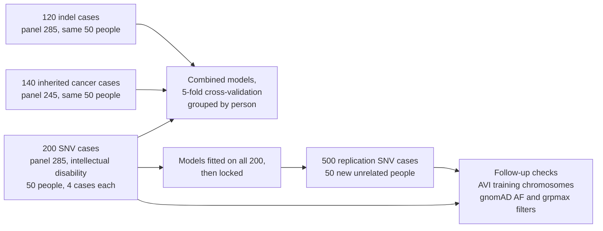
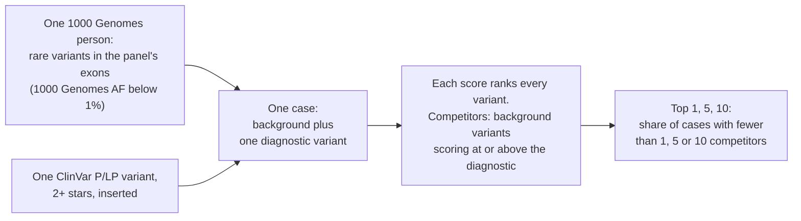
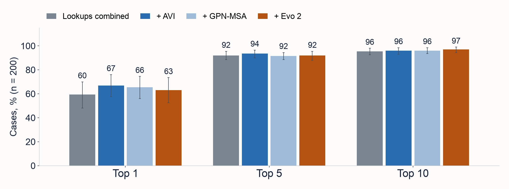
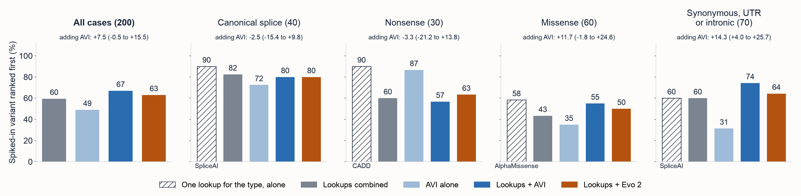
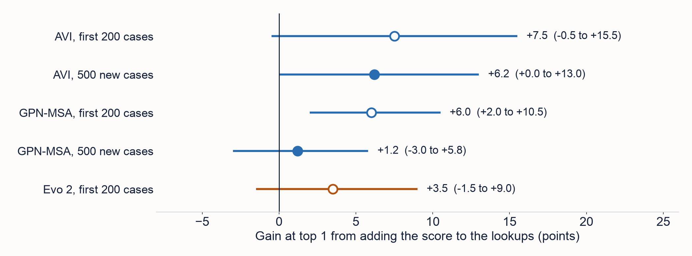
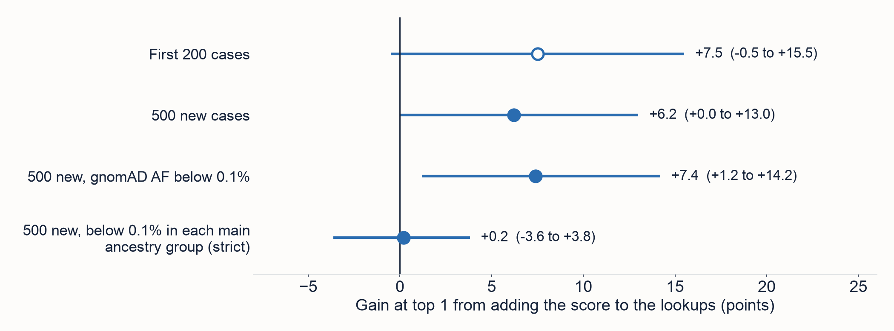
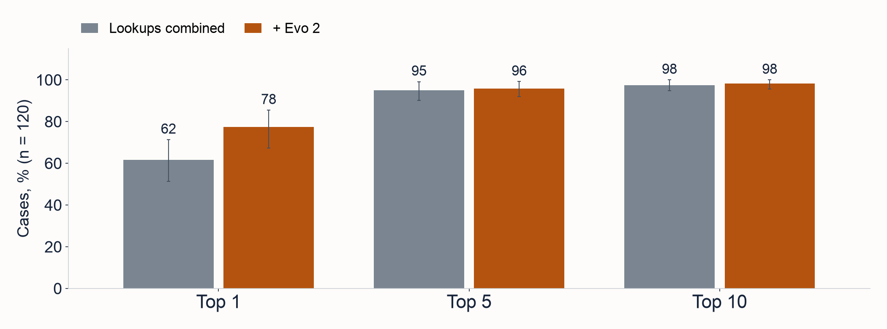
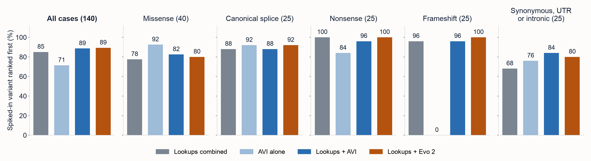

# Rare-disease case benchmark, first run

**Answer.** In simulated rare-disease cases, the four established lookups (CADD, SpliceAI, REVEL, AlphaMissense)
combined with consequence class did most of the work: they put the diagnostic variant first in 59.5% (48.0 to
70.0) of 200 SNV cases and in the top 5 in 92.0% (88.5 to 95.5). No foundation-model score did better on its own.
GPN-MSA's early gain did not replicate on 500 new cases. AlphaGenome AVI's gain on the new cases was similar in size
(+6.2 points, 0.0 to +13.0), but its interval reaches zero, and it vanished under the per-ancestry frequency filter a
pipeline uses (+0.2, -3.6 to +3.8). Evo 2 helped most on indels (+15.8, +5.0 to +26.8), but the second run, with
shorter lists and a higher baseline, finds +1.7 (-5.9 to +9.9). Review then found that the background people are in gnomAD, which flatters frequency. The second run in
[`rare-disease-v2/`](../rare-disease-v2/README.md) fixes that and finds no gain that matters from AVI (+1.8, -0.4 to
+4.0). Its result replaces this run's AVI claim.

Read the [paper (PDF)](paper/paper.pdf) for the full method and every number, the [README](README.md) for the
files, and [`REPLICATION.md`](REPLICATION.md) for the follow-up checks.

## Design

Four studies, one design. The SNV, indel and cancer studies use the same 50 people from 1000 Genomes. Panels: [PanelApp 285, Intellectual disability](https://panelapp.genomicsengland.co.uk/panels/285/) (v11.45) for the SNV, indel and replication studies, and [PanelApp 245, Adult solid tumours cancer susceptibility](https://panelapp.genomicsengland.co.uk/panels/245/) (v2.40) for the cancer study. The
replication uses 50 new people and models fitted on the 200 SNV cases, then locked.

## How a case works

Ties count against the score. A diagnostic variant with no score ranks last; background variants with no score are
dropped. Intervals are 95% bootstrap intervals over the 50 people.

## Charts

Top 1, 5 and 10 for the lookups combined, alone and with one foundation-model score added (200 SNV cases):

Top 1 by consequence group. The hatched bar is the one lookup suited to the group, alone. The combined model never
beats it:

Gains at top 1 from adding a score: the first 200 cases (hollow) against the 500 new cases with the model locked
(filled):

AVI's gain as the tests get stricter. It vanishes under the grpmax filter:

Indels (120 cases), with and without Evo 2:

Inherited cancer panel (140 cases). AVI scores no indels, so its frameshift bar is 0:

## Findings

Gains are in percentage points, rates in percent, both with 95% intervals. "Significant" means the interval
excludes zero (5% level, not adjusted for multiple comparisons). Only the GPN-MSA replication was planned before
its data were seen; every other row is exploratory.

| Finding | Estimate | 95% interval | Significant |
|---|---|---|---|
| Lookups combined, top 1, 200 SNV cases | 59.5% | 48.0 to 70.0 | |
| Lookups combined, top 5, 200 SNV cases | 92.0% | 88.5 to 95.5 | |
| Best single score (AVI), top 5, 200 SNV cases | 87.0% | 82.0 to 91.5 | |
| GPN-MSA added, top 1, 200 cases | +6.0 | +2.0 to +10.5 | Yes |
| GPN-MSA added, top 1, 500 new cases, locked | +1.2 | -3.0 to +5.8 | No (did not replicate) |
| AVI added, top 1, 200 cases | +7.5 | -0.5 to +15.5 | No |
| AVI added, top 1, 500 new cases, locked | +6.2 | 0.0 to +13.0 | No (interval reaches zero) |
| AVI added, top 1, 500 locked, gnomAD AF below 0.1% | +7.4 | +1.2 to +14.2 | Yes |
| AVI added, top 1, 500 locked, grpmax AF below 0.1% | +0.2 | -3.6 to +3.8 | No |
| Evo 2 added, top 1, 200 SNV cases | +3.5 | -1.5 to +9.0 | No |
| Evo 2 added, top 1, 120 indel cases | +15.8 | +5.0 to +26.8 | Yes |
| Evo 2 added, top 1, indels, gnomAD AF below 0.1% | +8.3 | +0.9 to +16.3 | Yes |
| Second run: Evo 2 added, top 1, 120 indel cases | +1.7 | -5.9 to +9.9 | No |
| Lookups combined, top 1, 140 cancer cases | 85.0% | 75.7 to 92.4 | |
| AVI added, top 1, 140 cancer cases | +3.6 | 0.0 to +7.3 | No (interval reaches zero) |
| Evo 2 added, top 1, 140 cancer cases | +4.3 | +0.7 to +9.3 | Yes |
| Second run: AVI added, top 1, 500 new cases, locked | +1.8 | -0.4 to +4.0 | No |

Sources: `results/results.json`, `results_replication.json`, `results_indel.json`, `results_cancer.json` and
the `_gnomad` files, at tag `amp-2026-v4`. The second-run AVI row is from
[`rare-disease-v2/README.md`](../rare-disease-v2/README.md) at tag `amp-2026-v5`; the second-run Evo 2 row is from
[`rare-disease-v2/results/indel_main.json`](../rare-disease-v2/results/indel_main.json) at commit `6697db7`.

## What it means

- A lab's existing lookups, combined with the consequence class, already rank the diagnosis first in most of these
  cases and in the top 5 in about nine in ten.
- A gain picked as the largest of several on 200 cases can shrink on new cases. GPN-MSA's did, from +6.0 to +1.2.
- AVI's gain in this run depended on a frequency signal the design flattered. With realistic frequencies and
  filters, the second run finds no gain that matters. Do not cite this run's AVI gain.
- Evo 2 helped on indels here, where no score table exists, but the second run, with shorter lists and a higher
  baseline, finds no gain that matters.

## Limits

- **The background people are in gnomAD**
  ([issue #1](https://github.com/rewire-bio/amp-2026-studies/issues/1)). Almost every background variant had been
  seen there (all but 14 of 13,145 in the 200 cases, and all 11,208 in the 500) and about three quarters of the
  diagnostic variants had not. That flatters any score that learned frequency, including AVI.
- **Other design problems** ([issue #2](https://github.com/rewire-bio/amp-2026-studies/issues/2)): the per-ancestry
  filter was only a side check, the combined model is a weak baseline within each variant type, two consequence
  annotations were mixed, and groups are small.
- **Inserted diagnoses.** Inheritance and phenotype are ignored; many diagnoses were carrier states.
- **Circularity.** ClinVar classifications partly used these scores, which favours them.
- **Few people.** 50 per study, so intervals are wide.

## Code and data

- Paper: [`paper/paper.pdf`](paper/paper.pdf), source [`paper/paper.md`](paper/paper.md)
- Method and files: [`README.md`](README.md); follow-up checks: [`REPLICATION.md`](REPLICATION.md)
- Main script: [`case_benchmark.py`](case_benchmark.py); case builder: [`build_cases.py`](build_cases.py)
- Results: [`results/`](results/); data: [`data/`](data/); Evo 2 runs: [`evo2/`](evo2/)
- Charts: [`figures/rd_charts.py`](figures/rd_charts.py)
- Second run: [`../rare-disease-v2/`](../rare-disease-v2/README.md)
