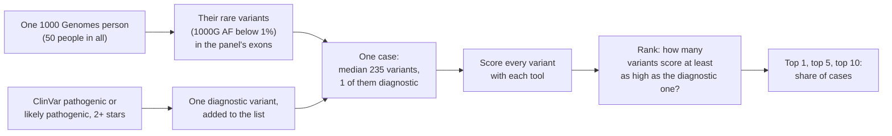
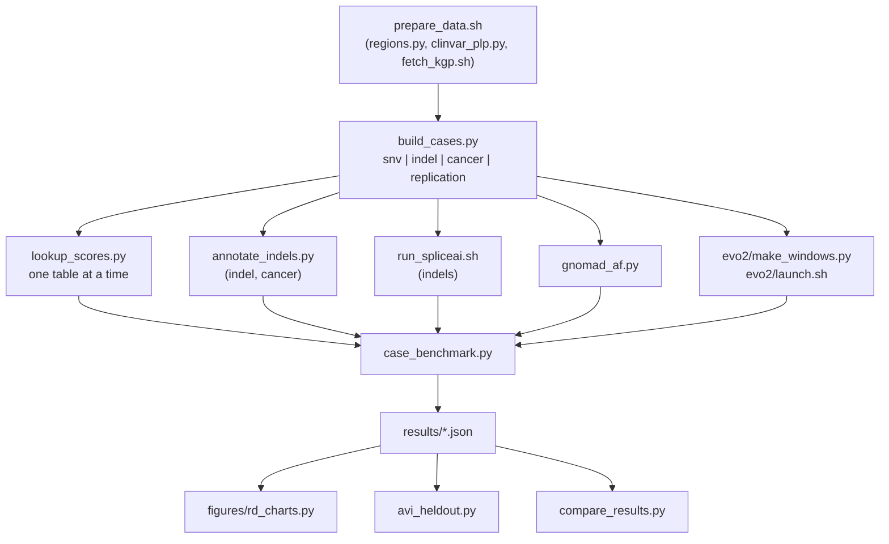

# Rare-disease case benchmark

If a lab sorts a patient's rare variants by a score, how often is the diagnostic variant at the top? This study
builds realistic cases and asks that question for nine scores, alone and combined.

## How a case is built



- **Background.** Each case is one 1000 Genomes high-coverage person's rare variants in the panel's green genes
  (MANE Select exons plus 20 bp). 1000 Genomes participants were not selected for disease, so the background is assumed to hold no diagnosis. Background
  variants that are themselves ClinVar P/LP are removed, so each case has one right answer.
- **Diagnostic variant.** One ClinVar P/LP variant with at least two review stars, inserted into the background. It is
  not observed in that person; inheritance and phenotype are ignored.
- **Rank.** For each score, count the background variants that score equal to or higher than the diagnostic variant.
  Ties count against the score. A missing score ranks last, as a failed lookup would in a pipeline.
- **Combined scores.** Logistic regression on the established lookups plus consequence class, with score-by-class
  terms, so that a score can count for missense variants and not for intronic ones. Fitted with 5-fold
  cross-validation grouped by background person, so no case is scored by a model that saw it. Each foundation-model
  score is then added to the lookups, one at a time, to measure what it adds.
- **Intervals.** 95% bootstrap intervals, 1,000 resamples of the 50 background people (each with all their cases).

`case_benchmark.py`'s docstring has the full method.

## The studies

| Study | Cases | Diagnostic variants | Panel | Result |
|---|---|---|---|---|
| SNVs | 200 (4 per person) | 60 missense, 40 canonical splice, 30 nonsense, 70 synonymous, UTR or intronic | PanelApp 285 Intellectual disability, 1,512 green genes | [`results/results.json`](results/results.json) |
| Indels (up to 50 bp) | 120 | 40 frameshift, 30 in-frame, 30 canonical splice, 20 UTR or intronic | same | [`results/results_indel.json`](results/results_indel.json) |
| Inherited cancer | 140 | 40 missense, 25 each of nonsense, frameshift, canonical splice, non-coding | PanelApp 245 Adult solid tumours cancer susceptibility | [`results/results_cancer.json`](results/results_cancer.json) |
| Replication of the SNV study | 500 (10 per person) | 150 missense, 100 canonical splice, 75 nonsense, 175 other; no position reused | 285, with 50 new unrelated people | [`results/results_replication.json`](results/results_replication.json) |
| Any of the above with a gnomAD frequency filter | as above, minus cases whose diagnostic variant is filtered out | | | `results/results[_<study>]_gnomad<af>[_grpmax].json` |
| AVI on held-out chromosomes | SNV and replication cases | | | [`results/avi_heldout.json`](results/avi_heldout.json) |

The indel and cancer studies oversample the rarer consequence groups, so that each group has enough cases.

## Scores

| Score | Kind | Source | Covers |
|---|---|---|---|
| CADD v1.7 (PHRED) | Established lookup | Remote tabix of the inclAnno files | All SNVs; indels seen in gnomAD |
| SpliceAI (max delta) | Established lookup | From CADD's annotation; run ourselves on indels (`run_spliceai.sh`) | SNVs, indels |
| REVEL v1.3 | Established lookup | Table in `evo2-cloud-operations` | Missense |
| AlphaMissense | Established lookup | hg38 table | Missense |
| GPN-MSA | Foundation-model table | Hugging Face `songlab/gpn-msa-hg38-scores` | All SNVs |
| GPN-Star vertebrate (V) and mammal (M) | Foundation-model table | Hugging Face `songlab/gpn-star-scores` | All SNVs |
| AlphaGenome AVI | Foundation-model table | Static all-SNV table from the AlphaGenome Atlas downloads page (88.5 GB) | All SNVs |
| Evo 2 7B | Foundation model, run ourselves | [`evo2/`](evo2/), one H100 | Every case variant except the 500 replication cases |

"Lookups combined" in the results means CADD, SpliceAI, REVEL and AlphaMissense with consequence class.

## Results

Share of cases with the diagnostic variant at rank 1, or within the top 5 (`strata.all.scores` in each file).

| Score | SNVs, top 1 | SNVs, top 5 | Indels, top 1 | Indels, top 5 | Cancer, top 1 | Cancer, top 5 |
|---|---|---|---|---|---|---|
| CADD v1.7 | 28.0% | 51.5% | 17.5% | 25.8% | 56.4% | 77.9% |
| SpliceAI | 39.5% | 54.5% | 41.7% | 62.5% | 42.9% | 63.6% |
| REVEL | 17.5% | 27.0% | | | 25.7% | 28.6% |
| AlphaMissense | 17.5% | 26.5% | | | 27.1% | 28.6% |
| GPN-MSA | 19.0% | 48.5% | | | 67.1% | 76.4% |
| GPN-Star-V | 30.0% | 57.5% | | | 67.1% | 76.4% |
| AlphaGenome AVI | 49.0% | 87.0% | | | 71.4% | 77.9% |
| Evo 2 7B | 16.5% | 43.0% | 57.5% | 92.5% | 72.9% | 97.9% |
| **Lookups combined** | **59.5%** | **92.0%** | **61.7%** | **95.0%** | **85.0%** | **97.9%** |

Blank cells: the score has no value for indels. The table-based scores cover no indels, and AVI covers none of the
30 cancer indel diagnostics, which therefore rank last for it.

Gain at top 1 from adding one score to the lookups (points, 95% interval; `strata.all.added_to_lookups`):

| Added score | SNVs | Indels | Cancer |
|---|---|---|---|
| GPN-MSA | +6.0 (+2.0 to +10.5) | 0 | +2.9 (+0.7 to +5.8) |
| GPN-Star-V | +4.0 (−1.5 to +11.0) | 0 | +5.0 (+1.4 to +10.1) |
| AlphaGenome AVI | +7.5 (−0.5 to +15.5) | | +3.6 (0.0 to +7.3) |
| Evo 2 7B | +3.5 (−1.5 to +9.0) | +15.8 (+5.0 to +26.8) | +4.3 (+0.7 to +9.3) |

These are the first results. [`REPLICATION.md`](REPLICATION.md) tests them in three ways:

1. **On 500 new cases.** GPN-MSA's +6 does not replicate. AVI's gain holds: +6.2 points with the model locked.
2. **Against AVI's training data.** AVI's lead is the same on the chromosomes it was not trained on.
3. **With a gnomAD frequency filter, as a pipeline would apply.** AVI's gain holds (+7.4 locked, interval above
   zero). GPN-MSA's falls to +2, and Evo 2's indel gain halves to +8.3. A stricter filter leaves short lists, where
   the lookups alone put the diagnostic variant first in 74 to 80% of cases.

## Limits

- The background people are in gnomAD (1000 Genomes is part of it), so every background variant has a gnomAD
  frequency while most diagnostic variants have none. A real patient's private variants are absent from gnomAD and
  compete with the diagnostic one, so frequency, and scores that learned it such as AVI, look stronger here than in
  practice. This also makes the gnomAD-filtered lists easier than a real patient's
  ([issue #1](https://github.com/rewire-bio/amp-2026-studies/issues/1)). The second run in
  [`../rare-disease-v2/`](../rare-disease-v2/) is designed to fix this.
- The diagnostic variant is inserted, not observed. Real cases have phenotype, inheritance and segregation to work
  with.
- ClinVar labels overlap with what some scores were trained on, which favours those scores on the diagnostic
  variants.
- 50 background people per study, so intervals are wide; the replication uses 50 different people.
- The combined model is a simple logistic regression. On missense variants it is worse at top 1 than AlphaMissense
  alone, so some of what an added score "gains" may make up for that.

## Files



| File | What it does |
|---|---|
| `prepare_data.sh` | Downloads the panel, MANE, ClinVar and 1000 Genomes genotypes, and picks the background people |
| `regions.py` | Panel green genes to MANE Select exon regions |
| `clinvar_plp.py` | ClinVar P/LP with 2+ stars, one row per allele, most severe consequence |
| `fetch_kgp.sh` | 1000 Genomes genotypes for the regions, one chromosome per call |
| `build_cases.py` | Builds one study's cases (`cases.tsv`) and its variant list (`case_variants.tsv`) |
| `lookup_scores.py` | Looks up each score table for every case variant (`scores_<source>.tsv`) |
| `annotate_indels.py` | Consequence class for every indel from MANE, independent of any score table |
| `run_spliceai.sh` | Runs SpliceAI 1.3.1 on the indels, as labs do for indels missing from precomputed files |
| `gnomad_af.py` | gnomAD genome AF and grpmax AF for every case variant (`data/gnomad_af.tsv`) |
| `case_benchmark.py` | Ranks, combines, bootstraps; writes `results/results[_<study>][_gnomad...].json` |
| `avi_heldout.py` | The AVI training-chromosome check |
| `compare_results.py` | Lists what changed in the results since an earlier tag |
| `figures/rd_charts.py` | The slide charts, into `figures/out/` |
| [`evo2/`](evo2/) | Evo 2 windows, the H100 runs and their receipts |
| [`data/`](data/) | Every input and intermediate file, described in its README |
| [`results/`](results/) | Every result file and its fields, described in its README |

## Rerunning

From this folder, in order. Downloads are large; each script's docstring gives details.

```sh
bash prepare_data.sh                                         # panel, MANE, ClinVar, 1000 Genomes
python3 regions.py 245 cancer                                # cancer study: its own regions and genotypes in data/cancer/
python3 build_cases.py snv                                   # also indel, cancer, replication
python3 lookup_scores.py [--study indel]                     # avi needs the table unpacked in data/avi/
python3 annotate_indels.py indel                             # and cancer
bash run_spliceai.sh                                         # indel and cancer studies
python3 gnomad_af.py                                         # for --gnomad-max-af
python3 evo2/make_windows.py && bash evo2/launch.sh          # optional: Evo 2 on one H100
uv run --with pandas --with numpy --with scikit-learn python case_benchmark.py [--study indel] [--gnomad-max-af 0.001 [--grpmax]]
uv run --with matplotlib python figures/rd_charts.py [--study indel] [--brand gel]
```

The committed `data/` holds the cases and most per-case scores. CADD and REVEL are not redistributed, so run
`lookup_scores.py cadd` and `lookup_scores.py revel` for each study first; then `case_benchmark.py` needs nothing else.

## Reproducibility

On 24 October 2026, rerunning `case_benchmark.py` reproduced `results_indel.json`, `results_cancer.json` and
`results_replication.json` byte for byte. In `results.json` every row reproduced except "Lookups + Evo 2" at top 1:
63.0% against the committed 62.5%. The code and the Evo 2 scores were unchanged, and scikit-learn 1.7.2 and 1.9.1
give the same rerun value; the cause is not known.

Adding AVI that day changed the order of the bootstrap draws, so most 95% intervals moved slightly, typically by 0.5
points or less. No point estimate changed except "Lookups + Evo 2". `results/compare_amp-2026-v1.txt` lists every
change. The committed results are the AVI rerun.
