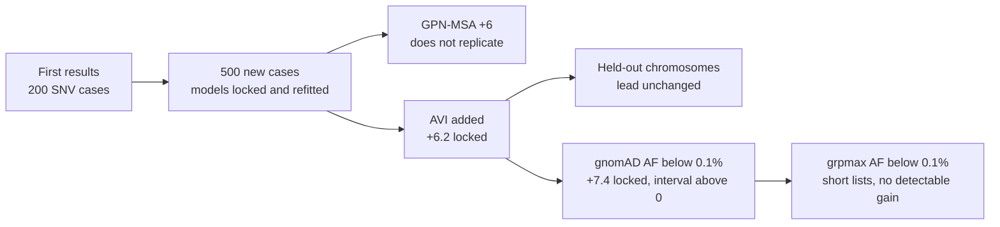

# Follow-up checks on the case benchmark

Three checks on the first results in [`README.md`](README.md), in the order they were run:

1. [Replication](#replication-does-gpn-msas-top-1-gain-hold-on-new-cases) (23 October 2026): do the gains hold on
   500 new cases with new background people?
2. [AlphaGenome AVI](#alphagenome-avi-added-24-october-2026) (24 October 2026): AVI added, and checked on the
   chromosomes it was not trained on.
3. [gnomAD frequency filter](#gnomad-frequency-filter-added-30-october-2026) (30 October 2026): do the results hold
   when common variants are removed first, as a diagnostic pipeline would?

## Replication: does GPN-MSA's top-1 gain hold on new cases?

Raised in review of the talk (issue 19 in the private decks repo). The original 200-case SNV benchmark (`results.json`) put the diagnostic variant at top 1 in 59.5% of
cases with the four lookups combined (CADD v1.7, SpliceAI, REVEL, AlphaMissense, plus consequence class) and 65.5%
with GPN-MSA added: +6.0 points, 95% CI +2.0 to +10.5. Top 5 and top 10 did not change. This is a test of that
result on 500 new cases.

### Method

- **Diagnostic variants.** 500 ClinVar 2-star P/LP SNVs in the same 1,512-gene intellectual-disability panel,
  none at a position used as a diagnostic in the original 200. Same consequence mix scaled to 500: 150 missense,
  100 canonical splice, 75 nonsense, 175 synonymous, UTR or intronic. Seed 20261023
  (`build_cases.py replication`).
- **Backgrounds.** 50 new 1000 Genomes high-coverage samples, drawn with seed 20261023 from the 2,504 unrelated
  samples, leaving out the original 50 and anyone in their families (2,425 eligible). The original 50 included 16
  of the 698 related samples; the new 50 include none. Superpopulations: EAS 13, EUR 12, AMR 9, AFR 8, SAS 8
  (original: AFR 12, EUR 11, EAS 11, SAS 10, AMR 6). Genotypes fetched by `fetch_kgp.sh` with the new sample file,
  except chrX and chr15. chrX was too slow as one remote stream and chr15 came back truncated at 25 Mb while still
  printing "done" (the script hides bcftools errors and the pipeline's exit status is the last command's). Both
  were refetched as 8 parallel region chunks and merged with `bcftools concat | bcftools norm -d exact`. Every
  chromosome was checked: 50 samples, last record within the last panel region, and 85 to 95% of the original
  record count. The original 50-sample files pass the same end-position check.
  Each sample carries 10 cases. Fewer African backgrounds give fewer rare variants: median 208.5 per case
  (original 234.5).
- **Scores.** CADD v1.7 (with SpliceAI), REVEL, AlphaMissense, GPN-MSA, GPN-Star vertebrate (V) and mammal (M), by
  `lookup_scores.py --study replication --reuse`, which copies rows for the 2,699 of 11,708 variants already
  scored in the original study. AlphaGenome AVI added on 24 October 2026 by `lookup_scores.py avi`, for these
  cases and the original 200. Evo 2 was not rerun.
- **Coverage of diagnostic variants.** CADD, GPN-MSA, GPN-Star V and M, AVI: 500/500 (100%). SpliceAI 475, REVEL 159,
  AlphaMissense 147 (of 150 missense).
- **Locked models.** "Lookups combined" and the same plus each of GPN-MSA, GPN-Star-V, GPN-Star-M and AVI are fitted once on all 200
  original cases, with the same features and logistic regression as `case_benchmark.py`, then applied unchanged to
  the 500 new cases.
- **Cross-validated.** The original analysis repeated on the 500 new cases alone: 5-fold cross-validation grouped
  by background sample.
- **Intervals.** 95% bootstrap intervals, 1,000 resamples of the 50 background samples (each with its 10 cases),
  as in the original. With 50 clusters the intervals are wider than 500 independent cases would give.

`case_benchmark.py --study replication` writes `results_replication.json`. Rerunning the original analysis from
this copy reproduces every lookup and GPN row of `results.json` exactly (scikit-learn 1.9.1); the Evo 2 rows
differ by one case.

### Results (500 cases, % with the diagnostic variant at or above rank k)

Locked models, fitted on the original 200 cases:

| Model | Top 1 | Top 5 | Top 10 |
|---|---|---|---|
| Lookups combined | 61.0 [53.6, 67.2] | 91.0 [88.6, 93.2] | 94.0 [91.8, 95.8] |
| Lookups + GPN-MSA | 62.2 [55.4, 68.8] | 91.6 [89.2, 93.6] | 94.2 [92.0, 96.0] |
| Lookups + GPN-Star-V | 64.0 [57.6, 70.4] | 91.6 [89.6, 93.6] | 94.4 [92.6, 96.2] |
| Lookups + GPN-Star-M | 63.6 [56.6, 70.2] | 91.8 [89.4, 94.0] | 96.0 [94.4, 97.4] |
| Lookups + AlphaGenome AVI | 67.2 [60.6, 73.8] | 93.8 [92.0, 95.4] | 96.0 [94.4, 97.4] |

Cross-validated on the 500 new cases:

| Model | Top 1 | Top 5 | Top 10 |
|---|---|---|---|
| Lookups combined | 58.2 [50.4, 65.0] | 92.6 [90.4, 94.6] | 95.8 [93.8, 97.4] |
| Lookups + GPN-MSA | 60.6 [54.0, 67.4] | 93.6 [91.6, 95.4] | 96.0 [94.4, 97.4] |
| Lookups + GPN-Star-V | 63.8 [57.6, 69.8] | 93.8 [92.4, 95.4] | 96.8 [95.2, 98.2] |
| Lookups + GPN-Star-M | 65.0 [59.2, 71.0] | 94.0 [92.2, 95.8] | 96.4 [94.8, 98.0] |
| Lookups + AlphaGenome AVI | 68.6 [61.8, 75.2] | 94.8 [93.0, 96.6] | 96.8 [95.4, 98.2] |

Gain over lookups combined, same cases (points):

| Added score | Original, top 1 | Locked, top 1 | CV, top 1 | Locked, top 5 | Locked, top 10 |
|---|---|---|---|---|---|
| GPN-MSA | +6.0 [+2.0, +10.5] | +1.2 [-3.0, +5.8] | +2.4 [-1.2, +6.0] | +0.6 [-1.0, +2.6] | +0.2 [-1.0, +1.6] |
| GPN-Star-V | +4.0 [-1.5, +11.0] | +3.0 [-1.2, +8.0] | +5.6 [+1.8, +9.8] | +0.6 [-1.0, +2.2] | +0.4 [-0.8, +1.8] |
| GPN-Star-M | +1.5 [-2.0, +5.5] | +2.6 [-2.0, +7.2] | +6.8 [+2.2, +11.4] | +0.8 [-0.6, +2.2] | +2.0 [+1.0, +3.2] |
| AlphaGenome AVI | +7.5 [-0.5, +15.5] | +6.2 [+0.0, +13.0] | +10.4 [+4.2, +17.4] | +2.8 [+0.8, +5.0] | +2.0 [+0.4, +3.6] |

One more observation. For missense diagnostics, the combined model is worse at top 1 than AlphaMissense alone
(replication CV: 35% against 67%; original: 43% against 58%). The combined model is not the best ranker
available at top 1, so some of what an added score "gains" there may be making up for that.

### Conclusion

The +6 point top-1 gain from adding GPN-MSA attenuates to the point of not replicating. On 500 new cases with new
backgrounds, +6.0 [+2.0, +10.5] becomes +1.2 [-3.0, +5.8] with the model locked from the original fit and +2.4
[-1.2, +6.0] when refitted on the new cases. Both intervals include zero, and the original estimate lies outside
the locked interval. The original estimate was the largest of four scores tested on 200 cases, so a
smaller value on new data is what one would expect. GPN-Star does a little better: +3 points at top 1 when locked
(interval includes zero) and +6 to +7 points when refitted on the larger set (interval excludes zero), so a small
top-1 gain from a conservation score is possible but not established; the refitted gains are the same "best of
several scores" pattern that produced the original GPN-MSA claim. At top 5 and top 10 none of the DNA language-model
scores changes the result by more than 2 points. For the slides: the lookups combined with consequence do the work,
and the DNA language-model scores (GPN-MSA, GPN-Star) add little or nothing.

## AlphaGenome AVI (added 24 October 2026)

AVI was tested after the analysis above, as one more table added to the same models. It is the one added score
whose top-1 gain holds on the new cases: +7.5 [-0.5, +15.5] on the original 200, +6.2 [+0.0, +13.0] locked and
+10.4 [+4.2, +17.4] refitted on the 500. It also gains at top 5 when locked, +2.8 [+0.8, +5.0]. The locked
interval's lower bound is zero, so the size of the gain is uncertain; its direction is consistent across all
three estimates.

Alone, AVI ranks the diagnostic variant in the top 5 in 87% of the original cases and 83% of the new ones, against
57.5% and 64% for GPN-Star-V, the best other single score, and 92% and 92.6% for the four lookups combined by a
fitted model. AVI is not a language-model score like GPN-MSA or GPN-Star: it is a trained combination of 18
features, AlphaGenome's predicted molecular effects plus AlphaMissense, conservation (PhastCons, Cactus) and
coding consequence flags. Its lead as a single score is partly a combination against single scores.

AVI's training labels are gnomAD frequency classes on chromosomes 1, 4, 7, 8, 10, 13 and 15, and 1000 Genomes is in
gnomAD, so background variants on those chromosomes may be AVI training examples. `avi_heldout.py` repeats the
single-score ranking within each set of chromosomes (`results/avi_heldout.json`). On the other chromosomes, AVI
puts the diagnostic variant in the top 5 in 91% of 157 original cases (GPN-Star-V 61%, SpliceAI 56%) and 88% of
387 new cases (GPN-Star-V 69%, SpliceAI 58%). AVI's lead does not depend on the training chromosomes. Within the
training chromosomes every score does better, because the backgrounds are smaller (median 75 and 63 variants).

## gnomAD frequency filter (added 30 October 2026)

The case backgrounds are rare in 1000 Genomes (AF below 1%) but were not filtered on gnomAD, which a diagnostic
pipeline does before ranking. AVI is trained to separate gnomAD-rare from gnomAD-common variants, so an unfiltered
background could favour it. `gnomad_af.py` looks up each variant's gnomAD genome AF and a grpmax AF (the maximum over
the afr, amr, eas, nfe and sas groups, the set gnomAD uses for genome grpmax) from MyVariant.info's `gnomad_genome` field (gnomAD v3.1.2 genomes, the
same genomes as gnomAD v4.1; spot checks match the v4.1 VCF exactly). Found in gnomAD: 97.2% of SNVs; for indels,
99.0% of background and 30% of diagnostic indels. A variant that is not found is kept, so a missed match can only
make the filter weaker. `case_benchmark.py --gnomad-max-af <af> [--grpmax]` drops variants at or above the
threshold and refits every model on what is left. The main filter is AF below 0.1%, the one the AlphaGenome Atlas
preprint uses for its rare-disease test.

AF below 0.1% removes about 60% of each background (median 235 to 124 variants for the 200 cases, 209 to 121 for
the 500) and no diagnostic variant. Top 5, single scores and the lookups combined:

| Cases | AVI | GPN-Star-V | CADD | SpliceAI | Evo 2 | Lookups combined |
|---|---|---|---|---|---|---|
| 200, unfiltered | 87% | 57.5% | 51.5% | 54.5% | 43% | 92% |
| 200, AF < 0.1% | 92.5% | 65.5% | 62.5% | 56.5% | 54.5% | 94% |
| 500, unfiltered | 82.8% | 63.8% | 55.8% | 53.6% | | 92.6% |
| 500, AF < 0.1% | 89.0% | 72.8% | 66.8% | 58.2% | | 96.0% |

Gain at top 1 from adding a score to the lookups (points, 95% interval):

| Added | 200, unfiltered | 200, AF < 0.1% | 500 locked, unfiltered | 500 locked, AF < 0.1% |
|---|---|---|---|---|
| AVI | +7.5 [-0.5, +15.5] | +8.0 [+0.5, +16.0] | +6.2 [+0.0, +13.0] | +7.4 [+1.2, +14.2] |
| GPN-MSA | +6.0 [+2.0, +10.5] | +2.0 [-3.0, +7.0] | +1.2 [-3.0, +5.8] | +1.2 [-3.6, +6.0] |
| GPN-Star-V | +4.0 [-1.5, +11.0] | +4.0 [-3.5, +11.5] | +3.0 [-1.2, +8.0] | +3.4 [-1.4, +8.6] |
| Evo 2 | +3.5 [-1.5, +9.0] | +1.5 [-3.5, +7.0] | | |

AVI's lead survives the filter and its added gain is, if anything, firmer: the locked interval on the 500 cases no
longer reaches zero. GPN-MSA's gain on the original 200 cases falls from +6 to +2 with the filter, so part of it came
from common background variants that a pipeline would have removed.

Indels (120 cases, AF < 0.1%, median 37 to 15 background indels): adding Evo 2 to the lookups gains +8.3 [+0.9,
+16.3] at top 1 (unfiltered +15.8 [+5.0, +26.8]), from a baseline of 71.7% (unfiltered 61.7%). By type the gain is
now frameshift +17.5 [+2.4, +33.3], in-frame +10.0 [-3.3, +24.1], UTR or intronic 0.0 [-13.6, +15.8] and canonical
splice 0.0; unfiltered it was mostly in-frame and non-coding. With 20 to 40 cases per type, which type the gain
comes from is not settled.

Inherited cancer panel (140 cases, AF < 0.1%, median 17 to 9 variants): the lookups combined reach 87.9% top 1 and
99.3% top 5; no added score gains more than 3 points at top 1 (AVI +2.9 [0.0, +8.6], Evo 2 +2.9 [0.0, +7.7]).

A stricter filter, grpmax AF below 0.1%, leaves a median of 51 (200 cases) and 34.5 (500 cases) background
variants and drops the cases whose diagnostic variant is itself above it (case180 DNAJC12; case176 WARS1, case448
DPYS). The lookups combined then reach 74% and 80% top 1 (78% locked on the 500), and no added score has a gain
whose interval excludes zero on either set (AVI +4.0 [-3.0, +12.1] on the 200; AVI locked +0.2 [-3.6, +3.8] on the
500).

Correction, 1 November 2026: the first version of this filter took grpmax over six groups including mid (Middle
Eastern), which gnomAD leaves out of genome grpmax. Dropping mid changed the grpmax status of 112 of 25,160 variants
(all now kept) and returned case288 PAH. Before the fix the figures were a median of 49 and 34, lookups 70% and 79%,
and AVI +7.5 [+0.5, +15.3] on the 200 and locked +0.8 [-3.4, +6.0] on the 500. The conclusion did not change. AF below 1% changes little (AVI locked +5.2 [-0.6,
+11.4]). Results: `results/results[_<study>]_gnomad<af>[_grpmax].json`.

Limit found later (1 November 2026): the background people are in gnomAD, so every background variant left after
this filter has a gnomAD frequency, while most diagnostic variants have none. A real patient's private variants are
absent from gnomAD and would stay in the list. The filtered lists here are therefore easier than a real patient's,
and the lookups' 74 to 80% top 1 under grpmax may be too high
([issue #1](https://github.com/rewire-bio/amp-2026-studies/issues/1)). The second run in
[`../rare-disease-v2/`](../rare-disease-v2/) uses frequencies without the 1000 Genomes samples.
