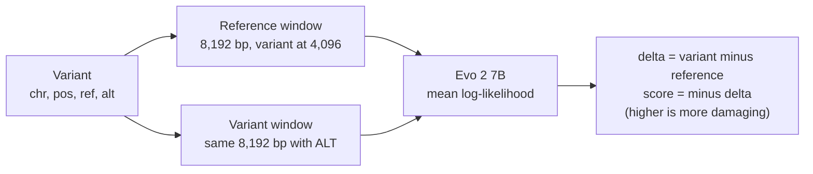

# Evo 2 7B on the case variants

Evo 2 is a DNA language model; no score table exists for it, so a lab would have to run it. We did that: every case
variant was scored on one rented NVIDIA H100, with the pinned container from
[rewire-bio/evo2-cloud-operations](https://github.com/rewire-bio/evo2-cloud-operations). The scores feed
`case_benchmark.py` as "Evo 2 7B".

## How a variant is scored



- Windows are 8,192 bp of GRCh38, centred as in Arc Institute's BRCA1 notebook, and uppercased; the model treats
  lowercase repeat-masked bases as different tokens.
- For an indel, the variant window keeps the reference length: REF is replaced by ALT and the right flank is refilled
  from the genome.
- Default numerics (bfloat16 weights, FP8 input projections, flash attention), batch size 1.

## The runs

| Folder | Date | Variants | Scored for | Pod time | Cost |
|---|---|---|---|---|---|
| `run/` | 16 to 17 Oct 2026 | 13,345 | The first build of the 200 SNV cases (`data/cases_run1.tsv`) | 2 h 50 min | about USD 11 |
| `run/scores_extra.tsv` | 16 Oct 2026, a second job on the same pod | 198 | Variants added in the final build of the 200 SNV cases | 5 min | (included above) |
| `run3/` | 19 Oct 2026 | 2,814 | Indel and cancer variants not scored before | 40 min | about USD 3 |

The 500 replication cases were not scored with Evo 2.

Throughput was 2.9 windows per second, with 16.8 GiB peak GPU memory, on an H100 80GB HBM3 at USD 3.99 per hour.
Costs are pod time from the launch logs multiplied by that rate.

## Files in each run folder

| File | Contents |
|---|---|
| `scores.tsv` | `chrom`, `pos`, `ref`, `alt`, `ref_score`, `var_score` (mean log-likelihoods), `evo2_delta` |
| `receipt.json` | GPU, numerics applied, window counts, load and scoring time, throughput, peak memory |
| `instance.json` | Provider, region, pod id, GPU, image digest, hourly price, host CUDA version |
| `host.txt` | GPU name and driver version |
| `ops_commit.txt` | The `evo2-cloud-operations` commit the scoring code came from |
| `code_sha256.txt` | Hash of the scoring code shipped to the pod |
| `events.jsonl` | Timestamped launch, running and completion events |
| `DONE` | Written by the pod when the job finished |

`launch.log` and `launch3.log` are the launcher's console output for the two pods.

## Scripts

| File | What it does |
|---|---|
| `make_windows.py` | Builds reference and variant windows from the case variants; `--skip-scored` leaves out variants already scored |
| `launch.sh` | Creates the pod, ships windows and code, polls for `DONE`, copies results back, deletes the pod. A hard cap (`MAX_HOURS`, default 5) also stops the pod from inside |
| `score_windows.py` | Runs on the pod: scores every window, resumable, writes `scores.tsv` and `receipt.json` |

```sh
python3 rare-disease/evo2/make_windows.py                       # from the repository root
RUNPOD_API_KEY=... bash rare-disease/evo2/launch.sh
DATA=rare-disease/evo2/data3 OUT=rare-disease/evo2/run3 bash rare-disease/evo2/launch.sh   # another window set
```

Not committed: the windows (`data*/`), raw per-window scores, SSH keys and the pod's own log.
